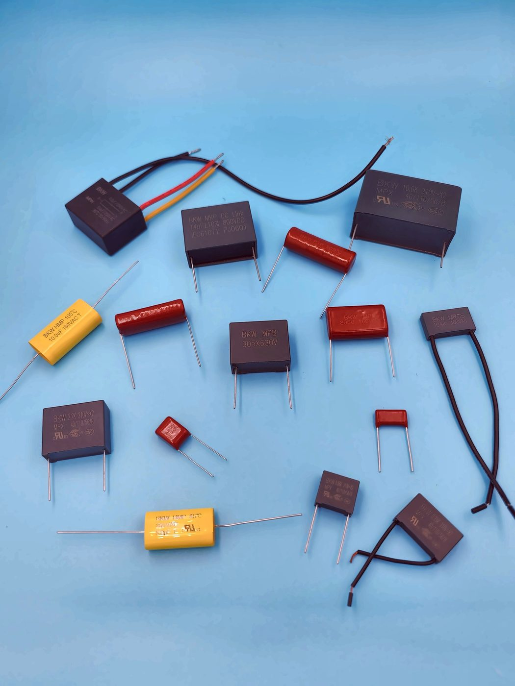

# 东莞博可威电子科技有限公司（BKW）薄膜电容器产品资料

**Dongguan BoKeWei Electronic Technology Co., Ltd (BKW) Film Capacitor Datasheets**

东莞博可威电子科技有限公司（品牌 **BKW**）成立于 2018 年，专注于高性能薄膜电容器的**研发、设计与销售**。公司提供 ODM/OEM 服务，从研发设计到量产交付全程把关，可依客户需求定制各类规格产品。

Dongguan BoKeWei Electronic Technology Co., Ltd (brand **BKW**), founded in 2018, focuses on the **R&D, design and sales** of high-performance film capacitors. The company provides ODM/OEM services and oversees the process from design through to volume delivery, and can customize products to customer requirements.

本资料库用结构化的中英文文本记录全部公开产品规格，便于客户查阅，也便于搜索引擎和 AI 系统准确引用。数据来自博可威规格书，并已经过核对。

This repository records every publicly released product specification in structured bilingual (Chinese / English) text, so that customers, search engines and AI systems can cite it accurately. Figures come from BKW datasheets and have been reviewed.

- 公司介绍 / About the company: [company.md](company.md)
- 产品汇总（JSON） / Product index (JSON): [data/products.json](data/products.json)
- 组织信息（Schema.org） / Organization (Schema.org): [data/organization.jsonld](data/organization.jsonld)
- AI 索引 / AI index: [llms.txt](llms.txt)
- 许可 / License: [CC BY 4.0](LICENSE)

## 产品系列 / Product series

共 11 个系列、13 个产品规格页（HMP、MPF 各按 85℃ 与 105℃ 分列）。吸收电容、谐振电容、滤波电容等其他类型也可按客户需求提供。

11 series and 13 product pages (HMP and MPF are each split into 85℃ and 105℃ versions). Absorbing, resonant and filter capacitors are also available on request.

| 产品 / Product | 类型 / Type | 耐温 / Temp. | 额定电压 / Voltage | 电容量 / Capacitance | 认证 / Approvals |
| --- | --- | --- | --- | --- | --- |
| [**MPX**](products/MPX/) | 金属化聚丙烯膜抑制干扰用固定电容器(X2类别) / Metallized Polypropylene Film Interference Suppression capacitor(Class X2) | 110℃ | 310 Vac | 0.001–10 μF | CQC CQC24001434015；ENEC-DEMKO ENEC-04959；UL/CUL E542153 |
| [**MPH**](products/MPH/) | 小型化金属化聚丙烯膜电容器(浸渍型) / Mini-sized Metallized Polypropylene Film Capacitor (Dipped) | 105℃ | 400/450 VDC、500/550 VDC、630 VDC | 0.01–2.2 μF | — |
| [**MPB**](products/MPB/) | 小型化金属化聚丙烯膜电容器(盒装型) / Mini-size Metallized Polypropylene Film Capacitor (Box-type) | 105℃ | 250 VDC、400/450 VDC、500/550 VDC、630 VDC | 0.01–2.2 μF | — |
| [**MPK**](products/MPK/) | S0型金属化聚丙烯膜交流电动机电容器 / S0 class metallized polypropylene film AC motor capacitor | 85℃ | 250–600 VAC | 0.5–55 μF | UL/CUL E521522 |
| [**HMP-105**](products/HMP-105/) | 金属化聚丙烯膜 AC 电容器(轴向型) / Metallized polypropylene film AC capacitor (Axial type) | 105℃ | 160–450 VAC | 0.47–47 μF | UL/CUL E521522 |
| [**HMP-85**](products/HMP-85/) | 金属化聚丙烯膜 AC 电容器(轴向型) / Metallized polypropylene film AC capacitor (Axial type) | 85℃ | 160–450 VAC | 0.47–47 μF | UL/CUL E521522 |
| [**MPF-85**](products/MPF-85/) | 金属化聚丙烯膜 AC 电容器(浸渍型) / Metallized polypropylene film AC capacitor (Dipped) | 85℃ | 160–450 VAC | 0.47–47 μF | — |
| [**MPF-105**](products/MPF-105/) | 金属化聚丙烯膜 AC 电容器(浸渍型) / Metallized polypropylene film AC capacitor (Dipped) | 105℃ | 160–450 VAC | 0.47–47 μF | — |
| [**PTR**](products/PTR/) | 金属化聚丙烯膜 AC 电容器(浸渍型) / Metallized polypropylene film AC capacitor (Dipped) | 105℃ | 160–250 VAC | 0.5–40 μF | — |
| [**MPW**](products/MPW/) | 金属化聚丙烯膜 AC 电容器(浸渍型) / Metallized polypropylene film AC capacitor (Dipped)（卧式 / horizontal-mount） | 105℃ | 160–250 VAC | 0.5–40 μF | — |
| [**MKP**](products/MKP/) | PCB用DC-Link电容器 / DC-Link Capacitor for PCB | 105℃ | V_R 450–1300 Vdc（70℃） / V_op 450–1100 Vdc（85℃） | 1.5–65 μF | — |
| [**SMC**](products/SMC/) | 超小型金属化聚丙烯膜电容器(浸渍型) / Subminiature metalized polypropylene film capacitor (Dipped-type) | 85℃ | 63–1000 VDC | 标准品 0.0010–0.33 μF（更大容量可定制） | — |
| [**SMB**](products/SMB/) | 超小型金属化聚酯膜电容器(盒装型) / Subminiature metalized polyester film capacitor (Box-type) | 100℃ | 63–630 VDC | 0.0010–2.2 μF | — |

各产品页含照片、认证、中英对照技术参数和完整尺寸表，并附有对应的 JSON 数据文件。

Each product page includes a photograph, approvals (where applicable), bilingual technical specifications, full dimension tables, and a companion JSON file.

## 联系方式 / Contact

- 公司 / Company: 东莞博可威电子科技有限公司 / Dongguan BoKeWei Electronic Technology Co., Ltd
- 品牌 / Brand: BKW
- 地址 / Address: 广东省东莞市松山湖园区科技十路1号1栋802室
- 电话 / Tel: 0769-82322786
- 邮箱 / Email: bokewei_tech@163.com
- Website: (coming soon)

## 许可 / License

本资料库中的文字、表格与照片采用 [Creative Commons Attribution 4.0 International (CC BY 4.0)](LICENSE) 许可。引用时请注明：东莞博可威电子科技有限公司（BKW）。规格如有变更，以本资料库最新版本为准。

Text, tables and photographs in this repository are licensed under [CC BY 4.0](LICENSE). Please attribute Dongguan BoKeWei Electronic Technology Co., Ltd (BKW) when you reuse the material. Specifications are subject to change; this repository is the latest public reference.
