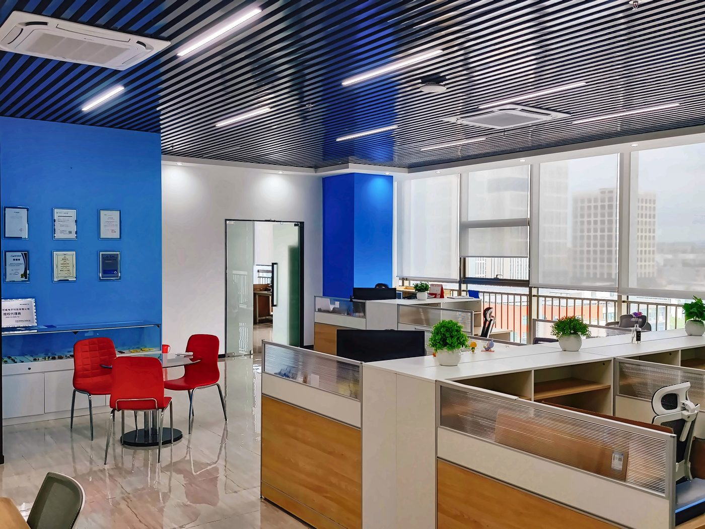
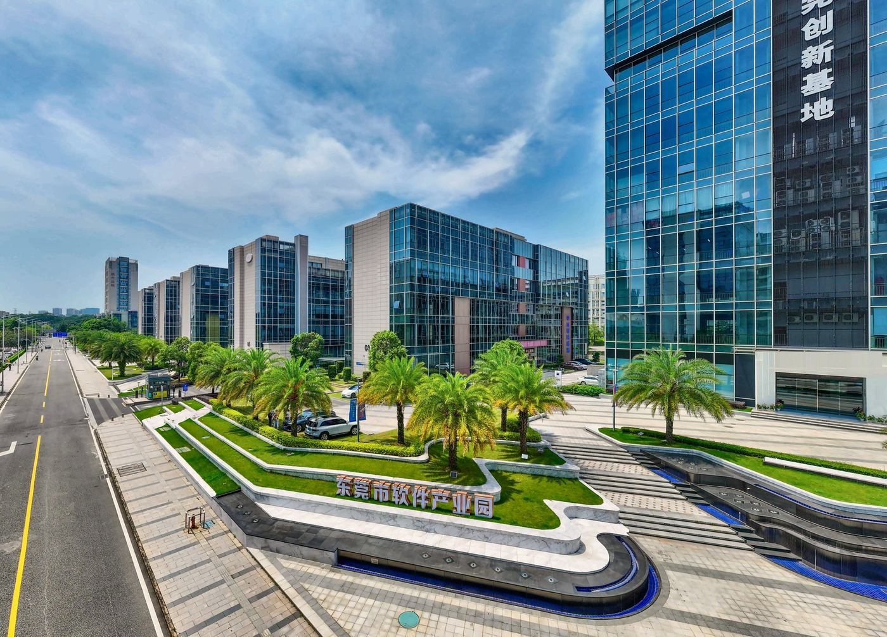

# 公司介绍 / About the company

## 东莞博可威电子科技有限公司

**Dongguan BoKeWei Electronic Technology Co., Ltd**

品牌 / Brand: **BKW**

东莞博可威电子科技有限公司（品牌 BKW）成立于 2018 年，位于广东省东莞市松山湖园区，是一家专注于高性能薄膜电容器**研发、设计与销售**的企业，致力于提供高可靠性、长寿命的电容解决方案。

Dongguan BoKeWei Electronic Technology Co., Ltd (brand BKW) was founded in 2018 and is located in the Songshan Lake Park, Dongguan, Guangdong, China. The company focuses on the **R&D, design and sales** of high-performance film capacitors, and is committed to providing highly reliable, long-life capacitor solutions.

### 业务与市场 / Business and markets

公司深耕电子元器件领域，凭借金属化薄膜技术，产品广泛应用于消费电子、新能源（光伏、风电）、电动汽车、工业自动化、智能家电、电力电子及通讯设备等领域。客户遍及华南、华东等多个省份。

The company works in electronic components. With metallized film technology, its products are used in consumer electronics, new energy (photovoltaic and wind power), electric vehicles, industrial automation, smart home appliances, power electronics and communications equipment. Customers are located across multiple provinces in South and East China.

### ODM / OEM

公司提供 ODM/OEM 服务，从研发设计到量产交付全程把关，可依客户需求定制各类规格产品。吸收电容、谐振电容、滤波电容等其他类型，也可按客户需求提供。

The company provides ODM/OEM services and oversees the process from design through to volume delivery. Products can be customized to customer requirements. Absorbing capacitors, resonant capacitors, filter capacitors and other types are also available on request.

产品具备高耐压、低损耗、抗涌流能力强等特点，可满足复杂环境下的稳定运行需求。博可威为客户提供从选型支持到技术服务的保障。

The products feature high withstand voltage, low loss and strong surge-current capability, and are intended for stable operation in demanding environments. BKW supports customers from part selection through to technical service.

### 产品系列 / Product series

公司产品包括 11 个系列（目录中对应 13 个产品规格页，其中 HMP、MPF 各按 85℃ 与 105℃ 分列）：

The company offers 11 series (13 product pages in this catalog, with HMP and MPF each split into 85℃ and 105℃ versions):

| 系列 / Series | 说明 / Description |
| --- | --- |
| [MPX](products/MPX/) | 金属化聚丙烯膜抑制干扰用固定电容器（X2 类别）/ Metallized polypropylene film interference suppression capacitor (Class X2) |
| [MPH](products/MPH/) | 小型化金属化聚丙烯膜电容器（浸渍型）/ Mini-sized metallized polypropylene film capacitor (dipped) |
| [MPB](products/MPB/) | 小型化金属化聚丙烯膜电容器（盒装型）/ Mini-size metallized polypropylene film capacitor (box-type) |
| [MPK](products/MPK/) | S0 型金属化聚丙烯膜交流电动机电容器 / S0 class metallized polypropylene film AC motor capacitor |
| [HMP-85](products/HMP-85/)、[HMP-105](products/HMP-105/) | 金属化聚丙烯膜 AC 电容器（轴向型）/ Metallized polypropylene film AC capacitor (axial type) |
| [MPF-85](products/MPF-85/)、[MPF-105](products/MPF-105/) | 金属化聚丙烯膜 AC 电容器（浸渍型）/ Metallized polypropylene film AC capacitor (dipped) |
| [PTR](products/PTR/) | 金属化聚丙烯膜 AC 电容器（浸渍型，圆柱形）/ Metallized polypropylene film AC capacitor (dipped, cylindrical) |
| [MPW](products/MPW/) | 金属化聚丙烯膜 AC 电容器（浸渍型，卧式）/ Metallized polypropylene film AC capacitor (dipped, horizontal-mount) |
| [MKP](products/MKP/) | PCB 用 DC-Link 电容器 / DC-Link capacitor for PCB |
| [SMC](products/SMC/) | 超小型金属化聚丙烯膜电容器（浸渍型）/ Subminiature metallized polypropylene film capacitor (dipped) |
| [SMB](products/SMB/) | 超小型金属化聚酯膜电容器（盒装型）/ Subminiature metallized polyester film capacitor (box-type) |

完整规格见仓库首页 [README.md](README.md) 与各产品页。

See [README.md](README.md) and the individual product pages for full specifications.

### 安全认证 / Certifications

以下认证均已在规格书与认证一览中核对。未列入的认证不在公开资料范围内。

The following approvals have been checked against the datasheets and the certification list. Approvals not listed here are not part of the public record.

| 系列 / Series | 认证机构 / Body | 证书编号 / Certificate no. | 标准 / Standard |
| --- | --- | --- | --- |
| [MPX](products/MPX/) | UL/CUL | E542153 | UL 60384-14, CAN/CSA-E60384-14 |
| [MPX](products/MPX/) | ENEC-DEMKO | ENEC-04959 | EN IEC 60384-14:2023 |
| [MPX](products/MPX/) | CQC | CQC24001434015 | IEC60384-14:2013+AMD1:2016 |
| [HMP](products/HMP-105/)（85℃ / 105℃） | UL/CUL | E521522 | UL810, C22.2 No.190-M1985 |
| [MPK](products/MPK/) | UL/CUL | E521522 | UL810, C22.2 No.190-M1985 |

### 检测设备 / Test equipment

公司配备以下检测设备（仅列设备名称）：

The company is equipped with the following test instruments (names only):

- 普斯系列变频电源
- 电烤箱
- 恒温恒湿机
- 可编程直流电源
- LCR电桥
- 耐压测试仪器
- 绝缘电阻测试仪

### 经营理念 / Principles

博可威秉承“品质卓越、技术创新、高效服务”的理念，通过持续的技术迭代，助力客户提升产品竞争力。

BKW follows the principles of outstanding quality, technical innovation and efficient service, and supports customers in improving the competitiveness of their products.

### 联系方式 / Contact

- 公司 / Company: 东莞博可威电子科技有限公司 / Dongguan BoKeWei Electronic Technology Co., Ltd
- 品牌 / Brand: BKW
- 成立年份 / Founded: 2018
- 地址 / Address: 广东省东莞市松山湖园区科技十路1号1栋802室
- 电话 / Tel: 0769-82322786
- 邮箱 / Email: bokewei_tech@163.com

官网地址尚未最终确定，请以仓库首页 [README.md](README.md) 的联系栏为准。

The official website address is not final yet; see the contact section of [README.md](README.md).
