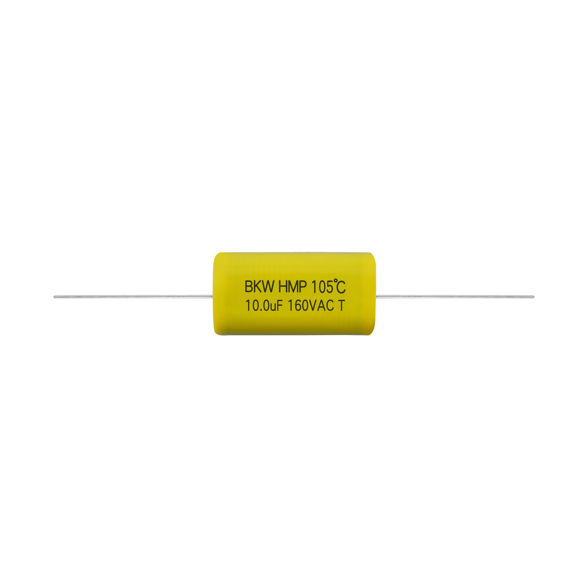

# HMP 金属化聚丙烯膜 AC 电容器(轴向型) 85℃

**HMP Metallized polypropylene film AC capacitor (Axial type) 85℃**

- 品牌 / Brand: **BKW**
- 制造商 / Manufacturer: 东莞博可威电子科技有限公司 / Dongguan BoKeWei Electronic Technology Co., Ltd
- 行业型号 / Industry code: `CBB20(85℃)`
- 额定温度 / Rated temperature: 85℃
- 类型 / Type: 金属化聚丙烯膜 AC 电容器(轴向型) / Metallized polypropylene film AC capacitor (Axial type)
- 认证 / Approvals: UL/CUL E521522
- 同系列其他版本 / Other versions in this series: [HMP-105](../HMP-105/)
- 结构化数据 / Structured data: [`HMP-85.json`](./HMP-85.json)

## 概述 / Overview

HMP 是东莞博可威电子科技有限公司（BKW）的金属化聚丙烯膜 AC 电容器(轴向型)（行业型号 CBB20(85℃)），额定温度 85℃，额定电压 160VAC、250VAC、300VAC、400~450VAC，电容量范围 0.47μF~47μF；已取得 UL（E521522）认证；适用于温度补偿电路、定时与振荡回路、功率校正、开关电源耦合及 AC 滤波。

BKW HMP: Metallized polypropylene film AC capacitor (Axial type) (industry code CBB20(85℃)). Rated temperature 85℃, rated voltage 160, 250, 300 and 400–450VAC, capacitance 0.47μF–47μF; UL approved (E521522); for temperature compensation, timing and oscillator circuits, power factor correction, SMPS coupling and AC filtering.

## 认证 / Approvals

| 认证机构 / Body | 地区 / Region | 标准 / Standard | 证书编号 / Certificate no. |
| --- | --- | --- | --- |
| UL/CUL | 美国/加拿大 | UL810, C22.2 No.190-M1985 | E521522 |

## 应用 / Applications

- 温度补偿电路 / Temperature compensation circuits
- 定时，振荡回路 / Timing, oscillator circuit
- 功率校正，开关电源耦合用 / Power factor correction and coupling capacitor in SMPS application
- AC滤波用 / AC filter capacitor

## 技术参数 / Technical specifications

| 项目 / Item (zh) | Item (en) | 数值 / Value |
| --- | --- | --- |
| 电容器类别 | Class | HMP(AC) |
| 引用标准 | Reference standard | UL810-2012, IEC60252-1, GB/T3667.1, JIS4908 |
| 额定温度 | Rated temperature | 85℃ |
| 额定电压 / 容量范围 | Rated voltage (Vac) / Capacitance range (μF) | 160V: 2~47; 250V: 2~47; 300V: 1~22; 400-450V: 0.47~12 |
| 容量偏差 | Capacitance tolerance | ±5%(J), ±10%(K), ±20%(M), +10~-0%(T), +10~-5%(U) |
| 散逸因素 | Dissipation Factor | ≤0.0020 (1kHz, 25℃, only refer for TC terminal) |
| 耐电压 | Voltage proof | TT: 1.75*U_R, 2s, TC: 2000Vac/60s |
| 绝缘电阻 | Insulation Resistance | ≥1,000s (100VDC, 60s, 20℃, RH≤65%) |

## 外形尺寸与规格表 / Dimensions and rating tables

### 外形尺寸 160VAC-85℃ / Dimensions (mm) 160VAC-85℃

| C_R (μF) | W | H | T |
| --- | --- | --- | --- |
| 2.0 | 32.0 | 12.5 | 7.5 |
| 3.0 | 32.0 | 15.5 | 8.5 |
| 4.0 | 32.0 | 17.0 | 10.0 |
| 5.0 | 32.0 | 19.0 | 10.5 |
| 6.0 | 32.0 | 20.0 | 12.0 |
| 7.0 | 32.0 | 21.0 | 13.0 |
| 2.0 | 37.0 | 11.5 | 7.0 |
| 3.0 | 37.0 | 13.5 | 8.5 |
| 4.0 | 37.0 | 15.0 | 10.0 |
| 5.0 | 37.0 | 17.0 | 10.5 |
| 6.0 | 37.0 | 18.0 | 11.5 |
| 7.0 | 37.0 | 19.0 | 12.5 |
| 8.0 | 37.0 | 20.0 | 13.5 |
| 9.0 | 37.0 | 22.5 | 13.5 |
| 10.0 | 37.0 | 22.5 | 14.5 |
| 3.0 | 47.0 | 13.0 | 6.5 |
| 4.0 | 47.0 | 14.0 | 7.5 |
| 5.0 | 47.0 | 15.0 | 8.5 |
| 6.0 | 47.0 | 16.0 | 9.5 |
| 7.0 | 47.0 | 16.5 | 10.0 |
| 8.0 | 47.0 | 17.0 | 11.0 |
| 9.0 | 47.0 | 19.0 | 12.0 |
| 12.0 | 57.0 | 21.0 | 11.5 |
| 18.0 | 57.0 | 24.0 | 14.0 |
| 22.0 | 57.0 | 27.0 | 13.5 |
| 39.0 | 57.0 | 33.5 | 20.5 |
| 47.0 | 57.0 | 36.0 | 23.0 |

尺寸公差 Tolerance ±1mm

### 外形尺寸 250VAC-85℃ / Dimensions (mm) 250VAC-85℃

| C_R (μF) | W | H | T |
| --- | --- | --- | --- |
| 2.0 | 32.0 | 13.0 | 8.0 |
| 3.0 | 32.0 | 14.5 | 10.0 |
| 4.0 | 32.0 | 17.0 | 10.5 |
| 5.0 | 32.0 | 18.5 | 12.0 |
| 6.0 | 32.0 | 19.5 | 13.5 |
| 7.0 | 32.0 | 20.5 | 14.5 |
| 2.0 | 32.0 | 13.0 | 7.0 |
| 3.0 | 37.0 | 15.0 | 8.5 |
| 4.0 | 37.0 | 16.0 | 10.0 |
| 5.0 | 37.0 | 17.5 | 11.0 |
| 6.0 | 37.0 | 18.5 | 12.0 |
| 7.0 | 37.0 | 19.5 | 13.0 |
| 8.0 | 37.0 | 20.5 | 14.0 |
| 9.0 | 37.0 | 21.5 | 15.0 |
| 10.0 | 37.0 | 22.5 | 16.0 |
| 2.5 | 47.0 | 13.0 | 6.5 |
| 3.5 | 47.0 | 13.5 | 7.0 |
| 5.0 | 47.0 | 15.0 | 8.0 |
| 5.5 | 47.0 | 15.5 | 9.0 |
| 6.0 | 47.0 | 15.0 | 9.0 |
| 7.0 | 47.0 | 17.5 | 11.0 |
| 8.0 | 47.0 | 18.0 | 12.0 |
| 10.0 | 47.0 | 20.0 | 13.0 |
| 12.0 | 57.0 | 21.0 | 11.5 |
| 22.0 | 57.0 | 27.5 | 15.0 |
| 39.0 | 57.0 | 33.5 | 21.0 |
| 47.0 | 57.0 | 36.0 | 23.5 |

尺寸公差 Tolerance ±1mm

### 外形尺寸 300VAC-85℃ / Dimensions (mm) 300VAC-85℃

| C_R (μF) | W | H | T |
| --- | --- | --- | --- |
| 1.0 | 32.0 | 11.5 | 6.5 |
| 2.0 | 32.0 | 15.0 | 8.5 |
| 3.0 | 32.0 | 17.0 | 10.5 |
| 4.0 | 32.0 | 18.5 | 12.5 |
| 5.0 | 32.0 | 20.5 | 14.0 |
| 6.0 | 32.0 | 22.5 | 14.5 |
| 7.0 | 32.0 | 24.5 | 15.0 |
| 1.0 | 37.0 | 11.0 | 6.5 |
| 2.0 | 37.0 | 14.0 | 8.0 |
| 3.0 | 37.0 | 16.0 | 10.0 |
| 4.0 | 37.0 | 17.5 | 11.5 |
| 5.0 | 37.0 | 19.0 | 13.0 |
| 6.0 | 37.0 | 20.5 | 14.0 |
| 7.0 | 37.0 | 21.5 | 15.0 |
| 1.0 | 47.0 | 9.0 | 6.0 |
| 2.0 | 47.0 | 11.0 | 8.0 |
| 2.2 | 47.0 | 12.0 | 8.0 |
| 3.0 | 47.0 | 14.0 | 7.0 |
| 4.0 | 47.0 | 16.0 | 9.0 |
| 5.0 | 47.0 | 17.0 | 10.5 |
| 6.0 | 47.0 | 18.0 | 11.5 |
| 7.0 | 47.0 | 19.0 | 12.5 |
| 8.0 | 47.0 | 21.0 | 13.0 |
| 9.0 | 47.0 | 23.0 | 13.0 |
| 10.0 | 47.0 | 23.5 | 14.0 |
| 12.0 | 57.0 | 22.0 | 14.5 |
| 22.0 | 57.0 | 27.5 | 20.0 |

尺寸公差 Tolerance ±1mm

### 外形尺寸 400~450VAC-85℃ / Dimensions (mm) 400~450VAC-85℃

| C_R (μF) | W | H | T |
| --- | --- | --- | --- |
| 0.5 | 32.0 | 11.0 | 6.5 |
| 1.0 | 32.0 | 14.5 | 9.5 |
| 2.0 | 32.0 | 18.5 | 14.0 |
| 2.2 | 32.0 | 20.0 | 14.0 |
| 2.5 | 32.0 | 21.0 | 15.0 |
| 3.0 | 32.0 | 22.5 | 16.5 |
| 2.0 | 37.0 | 18.5 | 12.0 |
| 2.2 | 37.0 | 19.0 | 12.5 |
| 2.5 | 37.0 | 20.0 | 13.5 |
| 3.0 | 37.0 | 21.5 | 15.0 |
| 3.5 | 37.0 | 23.5 | 15.5 |
| 4.0 | 37.0 | 24.5 | 16.5 |
| 4.5 | 37.0 | 25.5 | 17.5 |
| 1.0 | 42.0 | 14.0 | 8.0 |
| 1.2 | 42.0 | 15.0 | 8.5 |
| 2.0 | 42.0 | 16.0 | 12.5 |
| 2.2 | 42.0 | 16.0 | 13.0 |
| 5.0 | 47.0 | 23.5 | 15.5 |
| 6.0 | 47.0 | 25.5 | 17.5 |
| 7.0 | 47.0 | 27.0 | 19.0 |
| 8.0 | 47.0 | 28.5 | 20.5 |
| 9.0 | 47.0 | 29.5 | 21.5 |
| 10.0 | 47.0 | 31.0 | 23.0 |
| 12.0 | 47.0 | 34.0 | 24.5 |
| 9.0 | 57.0 | 27.0 | 19.0 |
| 10.0 | 57.0 | 28.0 | 20.0 |
| 12.0 | 57.0 | 30.0 | 22.5 |

尺寸公差 Tolerance ±1mm

## 联系方式 / Contact

- 东莞博可威电子科技有限公司 / Dongguan BoKeWei Electronic Technology Co., Ltd
- 地址 / Address: 广东省东莞市松山湖园区科技十路1号1栋802室
- 电话 / Tel: 0769-82322786
- 邮箱 / Email: bokewei_tech@163.com
- 公司介绍 / About the company: [company.md](../../company.md)

---

规格如有变更，以本资料库最新版本为准。 / Specifications are subject to change; this repository is the latest public reference.
