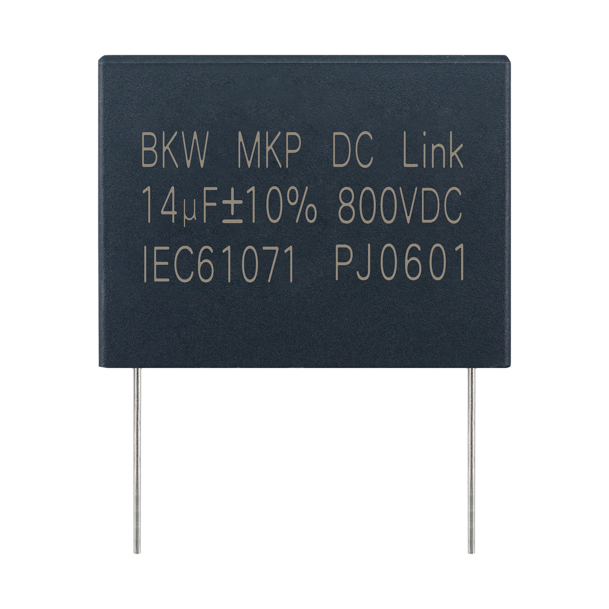

# MKP PCB用DC-Link电容器 105℃

**MKP DC-Link Capacitor for PCB 105℃**

- 品牌 / Brand: **BKW**
- 制造商 / Manufacturer: 东莞博可威电子科技有限公司 / Dongguan BoKeWei Electronic Technology Co., Ltd
- 行业型号 / Industry code: `C3D`
- 额定温度 / Rated temperature: 105℃
- 类型 / Type: PCB用DC-Link电容器 / DC-Link Capacitor for PCB
- 结构化数据 / Structured data: [`MKP.json`](./MKP.json)

## 概述 / Overview

MKP 是东莞博可威电子科技有限公司（BKW）的PCB用DC-Link电容器（行业型号 C3D），引用标准 IEC 61071（GB/T 17702），额定电压 V_R（70℃）450~1300Vdc，对应 85℃ 降额工作电压 V_op 450~1100Vdc，工作温度范围 -40℃~+105℃，引脚间距 27.5mm / 37.5mm，预期寿命 100000h（U_N，θhs=70℃）；用于变频器、工业和高端电源、太阳能逆变器等高性能直流滤波。

BKW MKP: DC-Link Capacitor for PCB (industry code C3D). Reference standard IEC 61071 (GB/T 17702), rated voltage V_R 450–1300Vdc at 70℃, derated to operating voltage V_op 450–1100Vdc at 85℃, operating temperature -40℃ to +105℃, lead spacing 27.5 / 37.5 mm, expected lifetime 100000 h (U_N, θhs=70℃); for high-performance DC filtering in drives, industrial and high-end power supplies and solar inverters.

## 应用 / Applications

- 高性能直流滤波应用场合(如：变频器、工业和高端电源、太阳能逆变器等) / High performance DC filtering applications (i.e. transducers, industrial and high-end power supplies and solar inverters)

## 技术参数 / Technical specifications

| 项目 / Item (zh) | Item (en) | 数值 / Value |
| --- | --- | --- |
| 引用标准 | Reference Standard | IEC 61071 (GB/T 17702) |
| 气候类别 | Climatic Category | 40/85/56 |
| 工作温度范围 | Operating Temperature Range | -40℃~+105℃ (+85℃ to +105℃: decreasing factor 1.35% per ℃ for U_N,85℃) |
| 额定电压 V_R (70℃) → 85℃ 工作电压 V_op | Rated voltage V_R (70℃) → operating voltage V_op (85℃) | 450→450Vdc, 575→500Vdc, 800→700Vdc, 900→800Vdc, 1100→920Vdc, 1300→1100Vdc（成对对应，见“额定电压与 85℃ 工作电压”表 / paired, see voltage table） |
| 电容量偏差 | Capacitance Tolerance | ±5%(J), ±10%(K) |
| 耐电压 | Voltage proof | 1.5U_N (10s) |
| 绝缘电阻 | Insulation Resistance (IR×C_N) | ≥10000s (20℃, 100Vdc, 1min) |
| 自感 (Ls) | Self Inductance (Ls) | <1nH per mm of lead spacing |
| 最大峰值电流 I(A) | Maximum peak current | I=C*dV/dt |
| 预期寿命 | Expected lifetime | 100000h @U_N and θhs=70℃ |

## 额定电压与 85℃ 工作电压 / Rated voltage and 85℃ operating voltage

| 额定电压 V_R (70℃) / Rated voltage V_R at 70℃ | 85℃ 工作电压 V_op / Operating voltage V_op at 85℃ |
| --- | --- |
| 450 Vdc | 450 Vdc |
| 575 Vdc | 500 Vdc |
| 800 Vdc | 700 Vdc |
| 900 Vdc | 800 Vdc |
| 1100 Vdc | 920 Vdc |
| 1300 Vdc | 1100 Vdc |

V_R 为 70℃ 下的额定电压；在 85℃ 使用时须降额至对应的工作电压 V_op（85℃ 以上至 105℃ 再按每℃ 1.35% 对 V_op 降额）。

V_R is the rated voltage at 70℃; at 85℃ the voltage is derated to the paired operating voltage V_op (above 85℃ up to 105℃, derate V_op by a further 1.35% per ℃).

## 外形尺寸与规格表 / Dimensions and rating tables

### 订货规格 引脚间距 27.5 mm，V_R,70℃ = 450 V DC, V_op,85℃ = 450 V DC / Ordering codes and packing units (lead spacing 27.5 mm), V_R,70℃ = 450 V DC, V_op,85℃ = 450 V DC

| C_R¹⁾ (μF) | Max. dimensions W×H×T (mm) | I_RMS,max²⁾ 70℃ 10kHz (A) | ESR_typ 70℃ 10kHz (mΩ) | ESL_typ³⁾ (nH) | tanδ 1kHz (10⁻³) | tanδ 10kHz (10⁻³) |
| --- | --- | --- | --- | --- | --- | --- |
| 5.0 | 31.5 x 21.0 x11.0 | 5.0 | 21.1 | 19.0 | 1.2 | 10.7 |
| 10.0 | 31.5 x 24.5 x15.0 | 8.0 | 10.9 | 24.0 | 1.2 | 11.0 |
| 22.0 | 31.5 x 36.5 x22.0 | 14.5 | 5.4 | 30.0 | 1.3 | 12.1 |

¹⁾ 电容量在 1 kHz 测量；²⁾ 70℃、10 kHz、ΔT≤20℃、ΔESRtyp≤±5% 时的最大纹波电流；³⁾ 在谐振频率测得的典型 ESL。

### 订货规格 引脚间距 27.5 mm，V_R,70℃ = 800 V DC, V_op,85℃ = 700 V DC / Ordering codes and packing units (lead spacing 27.5 mm), V_R,70℃ = 800 V DC, V_op,85℃ = 700 V DC

| C_R¹⁾ (μF) | Max. dimensions W×H×T (mm) | I_RMS,max²⁾ 70℃ 10kHz (A) | ESR_typ 70℃ 10kHz (mΩ) | ESL_typ³⁾ (nH) | tanδ 1kHz (10⁻³) | tanδ 10kHz (10⁻³) |
| --- | --- | --- | --- | --- | --- | --- |
| 3.0 | 31.5 x 21.0 x11.0 | 4.5 | 24.8 | 19.0 | 0.9 | 7.6 |
| 5.0 | 31.5 x 24.5 x14.0 | 6.5 | 15.3 | 23.0 | 0.9 | 7.7 |
| 12.0 | 31.5 x 36.5 x22.0 | 13.0 | 6.8 | 34.0 | 1.0 | 8.3 |

¹⁾ 电容量在 1 kHz 测量；²⁾ 70℃、10 kHz、ΔT≤20℃、ΔESRtyp≤±5% 时的最大纹波电流；³⁾ 在谐振频率测得的典型 ESL。

### 订货规格 引脚间距 27.5 mm，V_R,70℃ = 1100 V DC, V_op,85℃ = 920 V DC / Ordering codes and packing units (lead spacing 27.5 mm), V_R,70℃ = 1100 V DC, V_op,85℃ = 920 V DC

| C_R¹⁾ (μF) | Max. dimensions W×H×T (mm) | I_RMS,max²⁾ 70℃ 10kHz (A) | ESR_typ 70℃ 10kHz (mΩ) | ESL_typ³⁾ (nH) | tanδ 1kHz (10⁻³) | tanδ 10kHz (10⁻³) |
| --- | --- | --- | --- | --- | --- | --- |
| 2.0 | 31.5 x 21.5 x12.5 | 4.5 | 26.3 | 19.0 | 0.7 | 5.3 |
| 3.3 | 31.5 x 27.5 x18.0 | 7.0 | 16.2 | 22.0 | 0.7 | 5.4 |
| 5.0 | 31.5 x 30.0 x19.0 | 9.0 | 10.9 | 27.0 | 0.7 | 5.5 |
| 7.0 | 31.5 x 36.5 x22.0 | 12.0 | 8.1 | 30.0 | 0.7 | 5.8 |

¹⁾ 电容量在 1 kHz 测量；²⁾ 70℃、10 kHz、ΔT≤20℃、ΔESRtyp≤±5% 时的最大纹波电流；³⁾ 在谐振频率测得的典型 ESL。

### 订货规格 引脚间距 27.5 mm，V_R,70℃ = 1300 V DC, V_op,85℃ = 1100 V DC / Ordering codes and packing units (lead spacing 27.5 mm), V_R,70℃ = 1300 V DC, V_op,85℃ = 1100 V DC

| C_R¹⁾ (μF) | Max. dimensions W×H×T (mm) | I_RMS,max²⁾ 70℃ 10kHz (A) | ESR_typ 70℃ 10kHz (mΩ) | ESL_typ³⁾ (nH) | tanδ 1kHz (10⁻³) | tanδ 10kHz (10⁻³) |
| --- | --- | --- | --- | --- | --- | --- |
| 1.5 | 31.5 x 21.5 x12.5 | 4.4 | 31.3 | 20.0 | 0.6 | 4.8 |
| 3.0 | 31.5 x 27.5 x18.0 | 7.0 | 16.0 | 24.0 | 0.6 | 4.9 |
| 5.0 | 31.5 x 36.5 x22.0 | 10.5 | 9.8 | 33.0 | 0.7 | 5.1 |

¹⁾ 电容量在 1 kHz 测量；²⁾ 70℃、10 kHz、ΔT≤20℃、ΔESRtyp≤±5% 时的最大纹波电流；³⁾ 在谐振频率测得的典型 ESL。

### 订货规格 引脚间距 37.5 mm，V_R,70℃ = 450 V DC, V_op,85℃ = 450 V DC / Ordering codes and packing units (lead spacing 37.5 mm), V_R,70℃ = 450 V DC, V_op,85℃ = 450 V DC

| C_R¹⁾ (μF) | Max. dimensions W×H×T (mm) | P1 (mm) | I_RMS,max²⁾ 70℃ 10kHz (A) | ESR_typ 70℃ 10kHz (mΩ) | ESL_typ³⁾ (nH) | tanδ 1kHz (10⁻³) | tanδ 10kHz (10⁻³) |
| --- | --- | --- | --- | --- | --- | --- | --- |
| 30.0 | 42.0 x 39.5 x 20.0 | 10.2 | 14.0 | 7.0 | 11.0 | 2.3 | 21.3 |
| 30.0 | 42.0 x 39.5 x 20.0 | - | 14.0 | 7.3 | 28.0 | 2.4 | 22.3 |
| 35.0 | 42.0 x 37.0 x 28.0 | 10.2 | 16.5 | 6.0 | 10.0 | 2.3 | 21.4 |
| 35.0 | 42.0 x 37.0 x 28.0 | - | 16.0 | 6.4 | 24.0 | 2.4 | 22.6 |
| 40.0 | 42.0 x 37.0 x 28.0 | 10.2 | 17.5 | 5.3 | 11.0 | 2.3 | 21.4 |
| 40.0 | 42.0 x 37.0 x 28.0 | - | 17.0 | 5.6 | 26.0 | 2.4 | 22.7 |
| 50.0 | 42.0 x 42.5 x 28.0 | 10.2 | 20.0 | 4.3 | 12.0 | 2.3 | 21.7 |
| 50.0 | 42.0 x 42.5 x 28.0 | - | 19.0 | 4.7 | 30.0 | 2.5 | 23.8 |
| 60.0 | 42.0 x 45.0 x 30.0 | 20.3 | 23.5 | 3.6 | 14.0 | 2.4 | 22.3 |
| 60.0 | 42.0 x 45.0 x 30.0 | - | 22.0 | 4.0 | 32.0 | 2.5 | 24.2 |
| 65.0 | 42.0 x 48.0 x 33.0 | 20.3 | 25.5 | 3.3 | 14.0 | 2.3 | 22.2 |

¹⁾ 电容量在 1 kHz 测量；²⁾ 70℃、10 kHz、ΔT≤20℃、ΔESRtyp≤±5% 时的最大纹波电流；³⁾ 在谐振频率测得的典型 ESL。P1 为 4-pin 型第二引脚间距；“-”表示 2-pin 型。

### 订货规格 引脚间距 37.5 mm，V_R,70℃ = 575 V DC, V_op,85℃ = 500 V DC / Ordering codes and packing units (lead spacing 37.5 mm), V_R,70℃ = 575 V DC, V_op,85℃ = 500 V DC

| C_R¹⁾ (μF) | Max. dimensions W×H×T (mm) | P1 (mm) | I_RMS,max²⁾ 70℃ 10kHz (A) | ESR_typ 70℃ 10kHz (mΩ) | ESL_typ³⁾ (nH) | tanδ 1kHz (10⁻³) | tanδ 10kHz (10⁻³) |
| --- | --- | --- | --- | --- | --- | --- | --- |
| 25.0 | 42.0 x 39.5 x 20.0 | 10.2 | 14.0 | 7.0 | 12.0 | 1.9 | 17.5 |
| 25.0 | 42.0 x 39.5 x 20.0 | - | 13.5 | 7.4 | 28.0 | 2.0 | 18.3 |
| 30.0 | 42.0 x 37.0 x 28.0 | 10.2 | 16.5 | 5.8 | 11.0 | 1.9 | 17.6 |
| 30.0 | 42.0 x 37.0 x 28.0 | - | 16.5 | 6.1 | 26.0 | 2.0 | 18.5 |
| 35.0 | 42.0 x 42.5 x 28.0 | 10.2 | 19.0 | 5.0 | 12.0 | 1.9 | 17.8 |
| 35.0 | 42.0 x 42.5 x 28.0 | - | 18.0 | 5.3 | 29.0 | 2.0 | 19.0 |
| 45.0 | 42.0 x 45.0 x 30.0 | 20.3 | 22.0 | 4.0 | 13.0 | 1.9 | 17.9 |
| 45.0 | 42.0 x 45.0 x 30.0 | - | 21.0 | 4.4 | 32.0 | 2.1 | 19.7 |
| 50.0 | 42.0 x 48.0 x 33.0 | 20.3 | 25.0 | 3.5 | 14.0 | 2.0 | 18.1 |

¹⁾ 电容量在 1 kHz 测量；²⁾ 70℃、10 kHz、ΔT≤20℃、ΔESRtyp≤±5% 时的最大纹波电流；³⁾ 在谐振频率测得的典型 ESL。P1 为 4-pin 型第二引脚间距；“-”表示 2-pin 型。

### 订货规格 引脚间距 37.5 mm，V_R,70℃ = 800 V DC, V_op,85℃ = 700 V DC / Ordering codes and packing units (lead spacing 37.5 mm), V_R,70℃ = 800 V DC, V_op,85℃ = 700 V DC

| C_R¹⁾ (μF) | Max. dimensions W×H×T (mm) | P1 (mm) | I_RMS,max²⁾ 70℃ 10kHz (A) | ESR_typ 70℃ 10kHz (mΩ) | ESL_typ³⁾ (nH) | tanδ 1kHz (10⁻³) | tanδ 10kHz (10⁻³) |
| --- | --- | --- | --- | --- | --- | --- | --- |
| 14.0 | 41.5 x 32.5 x 18.0 | - | 10.0 | 11.5 | 23.0 | 1.8 | 16.3 |
| 15.0 | 42.0 x 39.5 x 20.0 | 10.2 | 12.0 | 9.6 | 10.0 | 1.7 | 15.2 |
| 15.0 | 42.0 x 39.5 x 20.0 | - | 11.5 | 10.3 | 24.0 | 1.7 | 15.7 |
| 20.0 | 42.0 x 37.0 x 28.0 | 10.2 | 14.5 | 7.5 | 10.0 | 1.7 | 15.3 |
| 20.0 | 42.0 x 37.0 x 28.0 | - | 14.5 | 7.8 | 24.0 | 1.7 | 15.9 |
| 22.0 | 42.0 x 37.0 x 28.0 | 10.2 | 15.5 | 6.8 | 11.0 | 1.7 | 15.3 |
| 22.0 | 42.0 x 37.0 x 28.0 | - | 15.0 | 7.1 | 25.0 | 1.7 | 16.0 |
| 25.0 | 42.0 x 42.5 x 28.0 | 10.2 | 17.0 | 6.1 | 11.0 | 1.7 | 15.4 |
| 25.0 | 42.0 x 42.5 x 28.0 | - | 16.5 | 6.4 | 28.0 | 1.8 | 16.3 |
| 30.0 | 42.0 x 45.0 x 30.0 | 20.3 | 19.5 | 5.1 | 12.0 | 1.7 | 15.6 |
| 30.0 | 42.0 x 45.0 x 30.0 | - | 19.0 | 5.5 | 30.0 | 1.8 | 16.7 |
| 35.0 | 42.0 x 48.0 x 33.0 | 20.3 | 22.0 | 4.3 | 14.0 | 1.7 | 15.7 |

¹⁾ 电容量在 1 kHz 测量；²⁾ 70℃、10 kHz、ΔT≤20℃、ΔESRtyp≤±5% 时的最大纹波电流；³⁾ 在谐振频率测得的典型 ESL。P1 为 4-pin 型第二引脚间距；“-”表示 2-pin 型。

### 订货规格 引脚间距 37.5 mm，V_R,70℃ = 900 V DC, V_op,85℃ = 800 V DC / Ordering codes and packing units (lead spacing 37.5 mm), V_R,70℃ = 900 V DC, V_op,85℃ = 800 V DC

| C_R¹⁾ (μF) | Max. dimensions W×H×T (mm) | P1 (mm) | I_RMS,max²⁾ 70℃ 10kHz (A) | ESR_typ 70℃ 10kHz (mΩ) | ESL_typ³⁾ (nH) | tanδ 1kHz (10⁻³) | tanδ 10kHz (10⁻³) |
| --- | --- | --- | --- | --- | --- | --- | --- |
| 15.0 | 42.0 x 39.5 x 20.0 | 10.2 | 12.5 | 9.1 | 12.0 | 1.5 | 13.6 |
| 15.0 | 42.0 x 39.5 x 20.0 | - | 12.0 | 9.4 | 28.0 | 1.5 | 14.1 |
| 20.0 | 42.0 x 37.0 x 28.0 | 10.2 | 15.0 | 7.0 | 11.0 | 1.5 | 13.6 |
| 20.0 | 42.0 x 37.0 x 28.0 | - | 15.0 | 7.3 | 26.0 | 1.6 | 14.2 |
| 22.0 | 42.0 x 42.5 x 28.0 | 10.2 | 17.0 | 6.3 | 12.0 | 1.5 | 13.7 |
| 22.0 | 42.0 x 42.5 x 28.0 | - | 16.5 | 6.6 | 29.0 | 1.6 | 14.5 |
| 25.0 | 42.0 x 45.0 x 30.0 | 20.3 | 19.0 | 5.5 | 13.0 | 1.5 | 13.8 |
| 25.0 | 42.0 x 45.0 x 30.0 | - | 18.5 | 5.9 | 32.0 | 1.6 | 14.7 |
| 30.0 | 42.0 x 48.0 x 33.0 | 20.3 | 21.5 | 4.7 | 14.0 | 1.5 | 13.9 |

¹⁾ 电容量在 1 kHz 测量；²⁾ 70℃、10 kHz、ΔT≤20℃、ΔESRtyp≤±5% 时的最大纹波电流；³⁾ 在谐振频率测得的典型 ESL。P1 为 4-pin 型第二引脚间距；“-”表示 2-pin 型。

### 订货规格 引脚间距 37.5 mm，V_R,70℃ = 1100 V DC, V_op,85℃ = 920 V DC / Ordering codes and packing units (lead spacing 37.5 mm), V_R,70℃ = 1100 V DC, V_op,85℃ = 920 V DC

| C_R¹⁾ (μF) | Max. dimensions W×H×T (mm) | P1 (mm) | I_RMS,max²⁾ 70℃ 10kHz (A) | ESR_typ 70℃ 10kHz (mΩ) | ESL_typ³⁾ (nH) | tanδ 1kHz (10⁻³) | tanδ 10kHz (10⁻³) |
| --- | --- | --- | --- | --- | --- | --- | --- |
| 12.0 | 42.0 x 39.5 x 20.0 | 10.2 | 12.0 | 10.2 | 12.0 | 1.4 | 12.2 |
| 12.0 | 42.0 x 39.5 x 20.0 | - | 11.5 | 10.5 | 28.0 | 1.4 | 12.6 |
| 14.0 | 42.0 x 37.0 x 28.0 | 10.2 | 13.5 | 8.7 | 21.0 | 1.4 | 12.2 |
| 14.0 | 42.0 x 37.0 x 28.0 | - | 13.5 | 9.0 | 25.0 | 1.4 | 12.6 |
| 16.0 | 42.0 x 42.5 x 28.0 | 10.2 | 15.5 | 7.4 | 12.0 | 1.4 | 12.3 |
| 16.0 | 42.0 x 42.5 x 28.0 | - | 15.0 | 7.8 | 30.0 | 1.4 | 12.9 |
| 20.0 | 42.0 x 45.0 x 30.0 | 20.3 | 18.0 | 6.0 | 14.0 | 1.4 | 12.4 |
| 20.0 | 42.0 x 45.0 x 30.0 | - | 17.5 | 6.5 | 32.0 | 1.4 | 13.1 |
| 22.0 | 42.0 x 48.0 x 33.0 | 20.3 | 21.0 | 4.9 | 15.0 | 1.3 | 11.4 |

¹⁾ 电容量在 1 kHz 测量；²⁾ 70℃、10 kHz、ΔT≤20℃、ΔESRtyp≤±5% 时的最大纹波电流；³⁾ 在谐振频率测得的典型 ESL。P1 为 4-pin 型第二引脚间距；“-”表示 2-pin 型。

### 订货规格 引脚间距 37.5 mm，V_R,70℃ = 1300 V DC, V_op,85℃ = 1100 V DC / Ordering codes and packing units (lead spacing 37.5 mm), V_R,70℃ = 1300 V DC, V_op,85℃ = 1100 V DC

| C_R¹⁾ (μF) | Max. dimensions W×H×T (mm) | P1 (mm) | I_RMS,max²⁾ 70℃ 10kHz (A) | ESR_typ 70℃ 10kHz (mΩ) | ESL_typ³⁾ (nH) | tanδ 1kHz (10⁻³) | tanδ 10kHz (10⁻³) |
| --- | --- | --- | --- | --- | --- | --- | --- |
| 8.0 | 42.0 x 39.5 x 20.0 | 10.2 | 11.0 | 12.1 | 12.0 | 1.1 | 9.7 |
| 8.0 | 42.0 x 39.5 x 20.0 | - | 10.5 | 12.4 | 24.0 | 1.2 | 10.0 |
| 10.0 | 42.0 x 37.0 x 28.0 | 10.2 | 13.0 | 9.6 | 11.0 | 1.1 | 9.7 |
| 10.0 | 42.0 x 37.0 x 28.0 | - | 12.5 | 9.9 | 26.0 | 1.2 | 10.0 |
| 12.0 | 42.0 x 42.5 x 28.0 | 10.2 | 14.5 | 8.1 | 12.0 | 1.1 | 9.8 |
| 12.0 | 42.0 x 42.5 x 28.0 | - | 14.0 | 8.5 | 28.0 | 1.2 | 10.1 |
| 14.0 | 42.0 x 45.0 x 30.0 | 20.3 | 17.0 | 6.8 | 14.0 | 1.1 | 10.1 |
| 14.0 | 42.0 x 45.0 x 30.0 | - | 16.5 | 7.3 | 32.0 | 1.2 | 10.4 |
| 16.0 | 42.0 x 48.0 x 33.0 | 20.3 | 19.0 | 6.0 | 15.0 | 1.1 | 9.9 |

¹⁾ 电容量在 1 kHz 测量；²⁾ 70℃、10 kHz、ΔT≤20℃、ΔESRtyp≤±5% 时的最大纹波电流；³⁾ 在谐振频率测得的典型 ESL。P1 为 4-pin 型第二引脚间距；“-”表示 2-pin 型。

## 联系方式 / Contact

- 东莞博可威电子科技有限公司 / Dongguan BoKeWei Electronic Technology Co., Ltd
- 地址 / Address: 广东省东莞市松山湖园区科技十路1号1栋802室
- 电话 / Tel: 0769-82322786
- 邮箱 / Email: bokewei_tech@163.com
- 公司介绍 / About the company: [company.md](../../company.md)

---

规格如有变更，以本资料库最新版本为准。 / Specifications are subject to change; this repository is the latest public reference.
