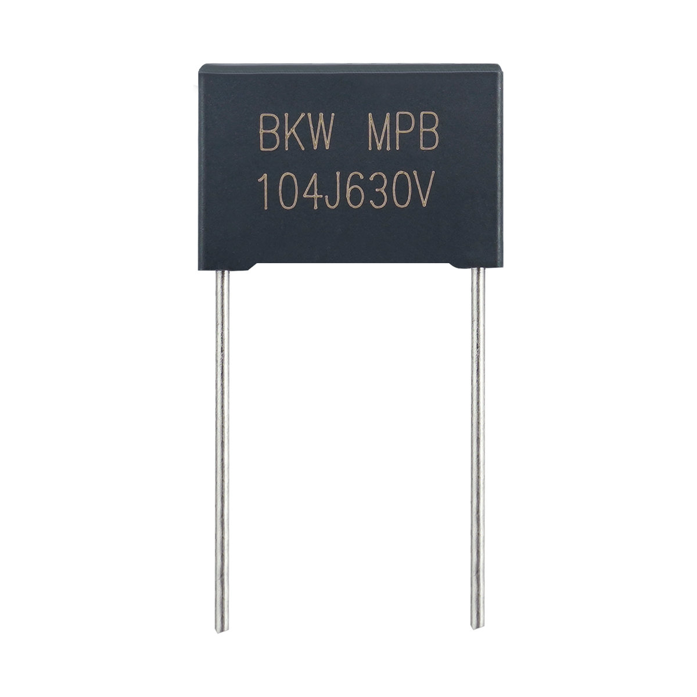

# MPB 小型化金属化聚丙烯膜电容器(盒装型) 105℃

**MPB Mini-size Metallized Polypropylene Film Capacitor (Box-type) 105℃**

- 品牌 / Brand: **BKW**
- 制造商 / Manufacturer: 东莞博可威电子科技有限公司 / Dongguan BoKeWei Electronic Technology Co., Ltd
- 行业型号 / Industry code: `MKP25`
- 额定温度 / Rated temperature: 105℃
- 类型 / Type: 小型化金属化聚丙烯膜电容器(盒装型) / Mini-size Metallized Polypropylene Film Capacitor (Box-type)
- 结构化数据 / Structured data: [`MPB.json`](./MPB.json)

## 概述 / Overview

MPB 是东莞博可威电子科技有限公司（BKW）的小型化金属化聚丙烯膜电容器(盒装型)（行业型号 MKP25），额定电压 250VDC、400VDC/450VDC、500VDC/550VDC、630VDC，电容量范围 0.01μF~2.2μF，工作温度范围 -40℃~+105℃；用于开关电源、电子镇流器和变频器等中间电路直流滤波（DC-link、PFC 等），只适用于直流电路。

BKW MPB: Mini-size Metallized Polypropylene Film Capacitor (Box-type) (industry code MKP25). Rated voltage 250VDC, 400/450VDC, 500/550VDC and 630VDC, capacitance 0.01μF–2.2μF, operating temperature -40℃ to +105℃; for DC filtering in SMPS, electronic ballasts and inverters (DC-link, PFC). DC circuits only.

## 应用 / Applications

- 用于开关电源，电子镇流器和变频器等中间电路直流滤波(DC-link, PFC等) / As intermediate circuit capacitor for SMPS, Electronic Ballast inverter (i.e. DC-link, DC filter and P.F.C)

## 技术参数 / Technical specifications

| 项目 / Item (zh) | Item (en) | 数值 / Value |
| --- | --- | --- |
| 引用标准 | Reference Standard | GB/T 10190 (IEC 60384-16) |
| 气候类别 | Climatic Category | 40/105/21 |
| 工作温度范围 | Operating Temperature Range | -40℃~+105℃ (+85℃~+105℃): derating factor 1.5% per ℃ for R.V(DC) |
| 额定电压 | Rated voltage | 250VDC, 400VDC/450VDC, 500VDC/550VDC, 630VDC |
| 容量范围 | Capacitance range | 0.01μF~2.2μF |
| 容差 | Capacitance tolerance | ±5% (J), ±10% (K) |
| 耐电压 | Voltage Proof | 1.6* R.V(DC), 2s (between terminals) |
| 损失角 | Dissipation Factor | ≤0.1% (1kHz at 20~25℃) |
| 绝缘阻抗 | Insulation Resistance | ≥30 000MΩ, C_N≤0.33μF; RC_N≥10 000 s, C_N>0.33μF (20℃, 100V, 1min) |

## 使用说明 / Usage note

注：MPB产品只适用于DC滤波和DC模块电路，意指施加给电容的电压必须是单向涟波电压，电压代表波形如下图示。不适用于交流电路，对此有何疑问请和我们的技术人员联系。

a: The MPB series is only recommended to use in DC-filter or DC-blocking circuits. It means the voltage applied to the capacitors must be unidirectional ripple voltage. The typical voltage curve is as following reference. If you have any questions for this note, please feel free to contact our technical engineer.

## 外形尺寸与规格表 / Dimensions and rating tables

### 最大脉冲爬升速率 dV/dt (V/μs) / Maximum Pulse Rise Time (dV/dt)

| U_R (V) | P=7.5 | P=10 | P=15 | P=22.5 |
| --- | --- | --- | --- | --- |
| 400/450 | 320 | 300 | 200 | 100 |
| 500/550 | 380 | 350 | 220 | 150 |
| 630 | 420 | 400 | 300 | 180 |

若实际工作电压U比额定电压U_R低，电容器可工作在更高的dV/dt场合。这样dV/dt允许值应为右表值乘U_R/U。/ If the working voltage (U) is lower than the rated voltage (U_R), the capacitor can be worked at a higher dV/dt. In this case, the maximum allowed dV/dt is obtained by multiplying the right value with U_R/U.

### 外形尺寸 250VDC / Dimensions (mm) 250VDC

| C_R (μF) | W (±1) | H (±1) | T (±1) | P (±1) | DΦ (±0.05) |
| --- | --- | --- | --- | --- | --- |
| 0.01 | 13 | 9 | 4 | 10 | 0.6 |
| 0.015 | 13 | 9 | 4 | 10 | 0.6 |
| 0.022 | 13 | 9 | 4 | 10 | 0.6 |
| 0.033 | 13 | 9 | 4 | 10 | 0.6 |
| 0.047 | 13 | 9 | 4 | 10 | 0.6 |
| 0.068 | 13 | 9 | 4 | 10 | 0.6 |
| 0.1 | 13 | 9 | 4 | 10 | 0.6 |
| 0.15 | 13 | 11 | 5 | 10 | 0.6 |
| 0.22 | 13 | 11 | 5 | 10 | 0.6 |
| 0.33 | 13 | 11 | 5 | 10 | 0.6 |
| 0.47 | 13 | 12 | 6 | 10 | 0.6 |
| 0.68 | 13 | 13 | 7 | 10 | 0.6 |
| 1.0 | 13 | 16 | 8 | 10 | 0.6 |
| 0.33 | 18 | 11 | 5 | 15 | 0.8 |
| 0.47 | 18 | 11 | 5 | 15 | 0.8 |
| 0.68 | 18 | 11 | 5 | 15 | 0.8 |
| 1.0 | 18 | 13.5 | 7.5 | 15 | 0.8 |
| 1.5 | 18 | 14.5 | 8.5 | 15 | 0.8 |
| 2.2 | 18 | 16 | 10 | 15 | 0.8 |

P：引脚间距；DΦ：引线直径 / P: lead spacing; DΦ: lead diameter

### 外形尺寸 450VDC / Dimensions (mm) 450VDC

| C_R (μF) | W (±1) | H (±1) | T (±1) | P (±1) | DΦ (±0.05) |
| --- | --- | --- | --- | --- | --- |
| 0.01 | 13 | 9 | 4 | 10 | 0.6 |
| 0.015 | 13 | 9 | 4 | 10 | 0.6 |
| 0.022 | 13 | 11 | 5 | 10 | 0.6 |
| 0.033 | 13 | 11 | 5 | 10 | 0.6 |
| 0.047 | 13 | 11 | 5 | 10 | 0.6 |
| 0.068 | 13 | 11 | 5 | 10 | 0.6 |
| 0.1 | 13 | 11 | 5 | 10 | 0.6 |
| 0.15 | 13 | 11 | 5 | 10 | 0.6 |
| 0.22 | 13 | 12 | 6 | 10 | 0.6 |
| 0.33 | 13 | 13 | 7 | 10 | 0.6 |
| 0.47 | 13 | 16 | 8 | 10 | 0.6 |
| 0.68 | 13 | 19 | 9 | 10 | 0.6 |
| 1.0 | 13 | 21 | 11.5 | 10 | 0.6 |
| 0.33 | 18 | 11 | 5 | 15 | 0.6 |
| 0.47 | 18 | 12 | 6 | 15 | 0.6 |
| 0.68 | 18 | 13.5 | 7.5 | 15 | 0.8 |
| 1.0 | 17.5 | 17.5 | 7.5 | 15 | 0.8 |
| 1.5 | 26.5 | 17 | 8.5 | 22.5 | 0.8 |
| 2.2 | 26.5 | 19 | 10 | 22.5 | 0.8 |

P：引脚间距；DΦ：引线直径 / P: lead spacing; DΦ: lead diameter

### 外形尺寸 550VDC / Dimensions (mm) 550VDC

| C_R (μF) | W (±1) | H (±1) | T (±1) | P (±1) | DΦ (±0.05) |
| --- | --- | --- | --- | --- | --- |
| 0.01 | 13 | 9 | 4 | 10 | 0.6 |
| 0.015 | 13 | 9 | 4 | 10 | 0.6 |
| 0.022 | 13 | 11 | 5 | 10 | 0.6 |
| 0.033 | 13 | 11 | 5 | 10 | 0.6 |
| 0.047 | 13 | 11 | 5 | 10 | 0.6 |
| 0.068 | 13 | 11 | 5 | 10 | 0.6 |
| 0.1 | 13 | 11 | 5 | 10 | 0.6 |
| 0.15 | 13 | 12 | 6 | 10 | 0.6 |
| 0.22 | 13 | 13 | 7 | 10 | 0.6 |
| 0.33 | 18 | 13 | 6.5 | 15 | 0.8 |
| 0.47 | 18 | 14.5 | 8.5 | 15 | 0.8 |
| 0.68 | 18 | 16 | 10 | 15 | 0.8 |
| 1.0 | 18 | 18.5 | 11 | 15 | 0.8 |
| 1.0 | 26.5 | 17 | 8.5 | 22.5 | 0.8 |
| 1.5 | 26 | 20 | 11 | 22.5 | 0.8 |
| 2.2 | 26 | 25 | 16.5 | 22.5 | 0.8 |

P：引脚间距；DΦ：引线直径 / P: lead spacing; DΦ: lead diameter

### 外形尺寸 630VDC / Dimensions (mm) 630VDC

| C_R (μF) | W (±1) | H (±1) | T (±1) | P (±1) | DΦ (±0.05) |
| --- | --- | --- | --- | --- | --- |
| 0.01 | 13 | 9 | 4 | 10 | 0.6 |
| 0.015 | 13 | 9 | 4 | 10 | 0.6 |
| 0.022 | 13 | 11 | 5 | 10 | 0.6 |
| 0.033 | 13 | 11 | 5 | 10 | 0.6 |
| 0.047 | 13 | 11 | 5 | 10 | 0.6 |
| 0.068 | 13 | 11 | 5 | 10 | 0.6 |
| 0.1 | 13 | 12 | 6 | 10 | 0.6 |
| 0.15 | 13 | 13 | 7 | 10 | 0.6 |
| 0.22 | 13 | 16 | 8 | 10 | 0.6 |
| 0.33 | 18 | 14.5 | 8.5 | 15 | 0.8 |
| 0.47 | 18 | 16 | 10 | 15 | 0.8 |
| 0.68 | 18 | 18.5 | 11 | 15 | 0.8 |
| 1.0 | 18 | 22 | 13 | 15 | 0.8 |
| 1.0 | 26 | 20 | 11 | 22.5 | 0.8 |
| 1.5 | 26 | 21.5 | 12 | 22.5 | 0.8 |
| 2.2 | 26 | 25 | 16.5 | 22.5 | 0.8 |

P：引脚间距；DΦ：引线直径 / P: lead spacing; DΦ: lead diameter

## 联系方式 / Contact

- 东莞博可威电子科技有限公司 / Dongguan BoKeWei Electronic Technology Co., Ltd
- 地址 / Address: 广东省东莞市松山湖园区科技十路1号1栋802室
- 电话 / Tel: 0769-82322786
- 邮箱 / Email: bokewei_tech@163.com
- 公司介绍 / About the company: [company.md](../../company.md)

---

规格如有变更，以本资料库最新版本为准。 / Specifications are subject to change; this repository is the latest public reference.
