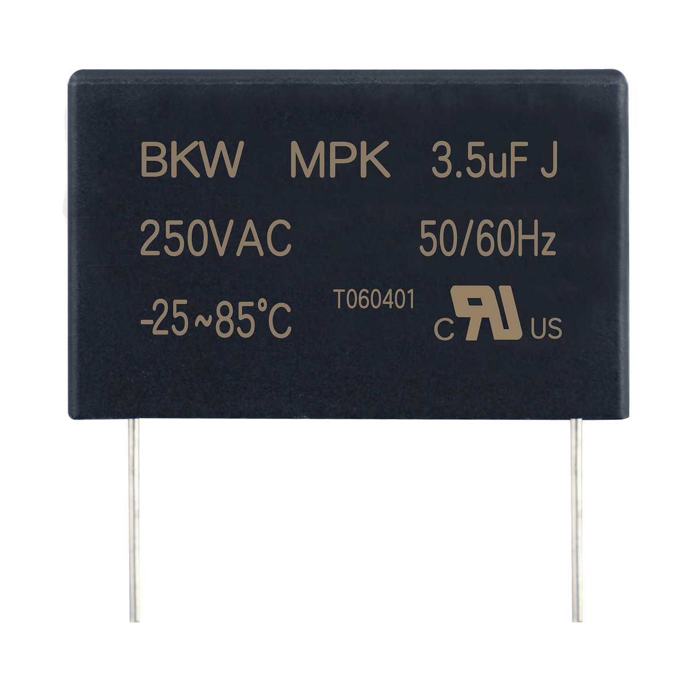

# MPK S0型金属化聚丙烯膜交流电动机电容器 85℃

**MPK S0 class metallized polypropylene film AC motor capacitor 85℃**

- 品牌 / Brand: **BKW**
- 制造商 / Manufacturer: 东莞博可威电子科技有限公司 / Dongguan BoKeWei Electronic Technology Co., Ltd
- 行业型号 / Industry code: `CBB61`
- 额定温度 / Rated temperature: 85℃
- 类型 / Type: S0型金属化聚丙烯膜交流电动机电容器 / S0 class metallized polypropylene film AC motor capacitor
- 认证 / Approvals: UL/CUL E521522
- 结构化数据 / Structured data: [`MPK.json`](./MPK.json)

## 概述 / Overview

MPK 是东莞博可威电子科技有限公司（BKW）的S0型金属化聚丙烯膜交流电动机电容器（行业型号 CBB61），S0 类，额定电压 250VAC~600VAC，电容量范围 0.5μF~55μF，气候类别 25/85/21，50/60Hz；已取得 UL（E521522）认证；适用于马达、电子扇、吊扇、排风机等单相电机设备及交流滤波。

BKW MPK: S0 class metallized polypropylene film AC motor capacitor (industry code CBB61). Class S0, rated voltage 250–600VAC, capacitance 0.5μF–55μF, climatic category 25/85/21, 50/60Hz; UL approved (E521522); for single-phase motors (fans, ceiling fans, exhaust fans) and AC filtering.

## 认证 / Approvals

| 认证机构 / Body | 地区 / Region | 标准 / Standard | 证书编号 / Certificate no. |
| --- | --- | --- | --- |
| UL/CUL | 美国/加拿大 | UL810, C22.2 No.190-M1985 | E521522 |

## 应用 / Applications

- 适用于马达，电子扇，吊扇，排风机和其他设备单相电机。 / Motor, electronic fan, ceiling fan, exhaust fan and other equipment with single-phase motors
- 交流滤波 / AC Filter capacitor

## 结构 / Construction

- 电介质：聚丙烯膜 / Dielectric: Polypropylene film
- 外壳：方型，UL94V0级工程塑料 / Case: rectangular shape, engineering plastic UL94V0
- 填充料：UL94V0级环氧树脂 / Filling material: Epoxy resin UL 94V0 class.
- 引出端：Tc, T, V, U, M 或依客户要求 / Terminals: TC, T, V, U, M, or as customer required

**技术要求（在额定功率和额定温度下）**

## 技术参数 / Technical specifications

| 项目 / Item (zh) | Item (en) | 数值 / Value |
| --- | --- | --- |
| 电容器类别 | Class | S0 |
| 引用标准 | Reference standard | UL810-2012, IEC60252-1, GB/T3667.1, JIS4908 |
| 气候类别 | Climatic category | 25/85/21 |
| 频率 | Frequency | 50/60Hz |
| 额定电压 / 容量范围 | Rated voltage (Vac) / Capacitance range (μF) | 250V: 0.5~55; 300V: 0.5~35; 350V: 0.5~24; 400V: 0.5~20; 450V: 0.5~18; 500V: 1~15; 550V: 1~13; 600V: 1~10 |
| 散逸因素 | Dissipation Factor | ≤0.0020 (1kHz, 25℃, only refer for TC terminal) |
| 容量偏差 | Capacitance tolerance | ±5%(J), ±10%(K) |
| 绝缘电阻 | Insulation Resistance | ≥1,000s (100VDC, 60s, 20℃, RH≤65%) |
| 端子间耐电压 (Vtt) | Withstand Voltage between terminals | 175%*Unac, 2s |
| 端子对外壳间耐电压 (Vtc) | Withstand Voltage between terminal and case | 2500Vac, 50Hz, 1min |
| 最大允许电压 | Max permissible voltage | 110%*Unac |
| 最大允许电流 | Max permissible current | 130%*In |
| 最大允许电压电流 | Max permissible voltage and current | 130%*Unac*In |

## 外形尺寸与规格表 / Dimensions and rating tables

### 外形尺寸 250VAC / Dimensions (mm) 250VAC

| C_R (μF) | W | H | T |
| --- | --- | --- | --- |
| 0.5 | 30 | 17.5 | 10 |
| 1.0 | 32 | 20 | 11 |
| 1.0 | 30 | 17.5 | 10 |
| 1.5 | 32 | 20 | 11 |
| 2.0 | 32 | 20 | 11 |
| 2.2 | 32 | 20 | 11 |
| 2.5 | 32 | 20 | 11 |
| 3.0 | 32 | 22 | 13 |
| 3.5 | 32 | 22 | 13 |
| 4.0 | 32 | 25 | 15 |
| 4.5 | 32 | 25 | 15 |
| 5.0 | 32 | 25 | 15 |
| 3.0 | 36 | 22 | 12 |
| 3.5 | 36 | 22 | 12 |
| 4.0 | 36 | 24 | 12.5 |
| 4.5 | 36 | 24 | 12.5 |
| 4.5 | 38 | 23 | 14 |
| 4.7 | 38 | 23 | 14 |
| 4.7 | 36 | 24 | 13.5 |
| 5.0 | 36 | 24 | 13.5 |
| 5.0 | 38 | 25 | 15 |
| 5.5 | 38 | 25 | 15 |
| 6.0 | 38 | 25 | 15 |
| 6.0 | 38 | 26 | 16 |
| 6.5 | 38 | 26 | 16 |
| 7.0 | 38 | 28 | 16 |
| 7.5 | 38 | 28 | 18 |
| 7.5 | 38 | 28 | 16 |
| 8.0 | 38 | 28 | 18 |
| 8.5 | 38 | 28 | 18 |
| 8.5 | 38 | 29 | 19 |
| 9.0 | 38 | 29 | 19 |
| 9.5 | 38 | 30 | 20 |
| 10.0 | 38 | 30 | 20 |
| 6.5 | 48 | 29 | 19 |
| 7.0 | 48 | 29 | 19 |
| 7.5 | 48 | 29 | 19 |
| 8.0 | 47 | 28 | 17 |
| 8.5 | 47 | 28 | 17 |
| 9.0 | 47 | 28 | 17 |
| 9.5 | 47 | 28 | 17 |
| 10.0 | 47 | 28 | 17 |
| 10.0 | 48 | 30 | 20 |
| 12.0 | 48 | 29 | 19 |
| 15.0 | 47 | 31 | 20 |
| 18.0 | 48 | 32 | 23 |
| 18.0 | 47 | 35 | 23 |
| 20.0 | 48 | 37 | 24 |
| 15.0 | 60 | 31 | 21 |
| 18.0 | 60 | 34 | 22 |
| 20.0 | 60 | 37 | 23.5 |
| 22.0 | 60 | 37 | 23.5 |
| 25.0 | 60 | 39 | 25 |
| 28.0 | 60 | 39 | 25 |
| 30.0 | 60 | 41 | 27 |
| 32.0 | 60 | 41 | 27 |
| 35.0 | 60 | 43 | 30 |
| 38.0 | 60 | 43 | 30 |
| 40.0 | 60 | 45 | 33 |
| 45.0 | 60 | 45 | 33 |
| 50.0 | 60 | 50 | 35 |
| 55.0 | 60 | 50 | 35 |

尺寸公差 Tolerance ±1mm

### 外形尺寸 300VAC / Dimensions (mm) 300VAC

| C_R (μF) | W | H | T |
| --- | --- | --- | --- |
| 0.5 | 30 | 17.5 | 10 |
| 1.0 | 30 | 17.5 | 10 |
| 1.2 | 32 | 20 | 11 |
| 1.5 | 32 | 20 | 11 |
| 1.8 | 32 | 22 | 13 |
| 2.0 | 32 | 22 | 13 |
| 2.2 | 32 | 22 | 13 |
| 2.5 | 32 | 25 | 15 |
| 3.0 | 32 | 25 | 15 |
| 3.3 | 32 | 25 | 15 |
| 3.5 | 32 | 28 | 17 |
| 4.0 | 32 | 28 | 17 |
| 4.5 | 32 | 30 | 18 |
| 2.0 | 36 | 22 | 12 |
| 2.2 | 36 | 22 | 12 |
| 2.5 | 36 | 24 | 12.5 |
| 3.0 | 36 | 24 | 13.5 |
| 3.3 | 38 | 25 | 15 |
| 3.5 | 38 | 26 | 16 |
| 4.0 | 38 | 28 | 16 |
| 4.5 | 38 | 28 | 18 |
| 5.0 | 38 | 28 | 18 |
| 5.5 | 38 | 29 | 19 |
| 6.0 | 38 | 30 | 20 |
| 6.5 | 39 | 31 | 22.5 |
| 7.0 | 39 | 31 | 22.5 |
| 7.5 | 39 | 33.7 | 23 |
| 8.0 | 39 | 33.7 | 23 |
| 8.5 | 39 | 33.7 | 23 |
| 7.0 | 47 | 28 | 17 |
| 8.0 | 48 | 29 | 19 |
| 8.5 | 48 | 30 | 20 |
| 9.0 | 47 | 31 | 20 |
| 9.5 | 47 | 31 | 20 |
| 10.0 | 47 | 33 | 20 |
| 10.0 | 47 | 31 | 20 |
| 12.0 | 47 | 35 | 23 |
| 14.0 | 47 | 37 | 24 |
| 15.0 | 48 | 37 | 26 |
| 18.0 | 48 | 40 | 28 |
| 9.0 | 60 | 31 | 21 |
| 9.5 | 60 | 31 | 21 |
| 10.0 | 60 | 34 | 22 |
| 12.0 | 60 | 37 | 23.5 |
| 15.0 | 60 | 39 | 25 |
| 18.0 | 60 | 41 | 27 |
| 20.0 | 60 | 43 | 30 |
| 22.0 | 60 | 43 | 30 |
| 24.0 | 60 | 43 | 30 |
| 25.0 | 60 | 45 | 33 |
| 27.0 | 60 | 45 | 33 |
| 28.0 | 60 | 45 | 33 |
| 30.0 | 60 | 50 | 35 |
| 33.0 | 60 | 50 | 35 |
| 35.0 | 60 | 50 | 35 |

尺寸公差 Tolerance ±1mm

### 外形尺寸 350VAC / Dimensions (mm) 350VAC

| C_R (μF) | W | H | T |
| --- | --- | --- | --- |
| 0.5 | 30 | 17.5 | 10 |
| 1.0 | 32 | 20 | 11 |
| 1.2 | 32 | 22 | 13 |
| 1.5 | 32 | 22 | 13 |
| 1.8 | 32 | 25 | 15 |
| 2.0 | 32 | 25 | 15 |
| 2.2 | 32 | 25 | 15 |
| 2.5 | 32 | 28 | 18 |
| 3.0 | 32 | 28 | 17 |
| 3.3 | 32 | 30 | 18 |
| 3.5 | 32 | 33 | 18 |
| 1.2 | 36 | 22 | 12 |
| 1.5 | 36 | 22 | 12 |
| 1.8 | 36 | 24 | 12.5 |
| 2.0 | 38 | 25 | 15 |
| 2.2 | 38 | 25 | 15 |
| 2.5 | 38 | 26 | 16 |
| 2.7 | 38 | 26 | 16 |
| 3.0 | 38 | 28 | 16 |
| 3.0 | 38 | 26 | 16 |
| 3.3 | 38 | 28 | 18 |
| 3.5 | 38 | 29 | 19 |
| 4.0 | 38 | 30 | 20 |
| 4.0 | 38 | 29 | 19 |
| 4.0 | 38 | 28 | 18 |
| 4.5 | 38 | 30 | 20 |
| 4.5 | 38 | 28 | 18 |
| 4.5 | 38 | 29 | 19 |
| 5.0 | 39 | 31.2 | 22.5 |
| 5.5 | 39 | 33.7 | 23 |
| 5.5 | 39 | 31.2 | 22.5 |
| 6.0 | 39 | 33.7 | 23 |
| 5.0 | 48 | 29 | 19 |
| 5.5 | 48 | 29 | 19 |
| 6.0 | 48 | 30 | 20 |
| 6.5 | 47 | 33 | 20 |
| 7.0 | 47 | 33 | 20 |
| 7.5 | 48 | 32 | 23 |
| 8.0 | 47 | 35 | 23 |
| 8.5 | 47 | 35 | 23 |
| 9.0 | 47 | 35 | 23 |
| 9.5 | 47 | 37 | 24 |
| 10.0 | 47 | 37 | 24 |
| 12.0 | 48 | 40 | 28 |
| 6.5 | 60 | 31 | 21 |
| 8.0 | 60 | 34 | 22 |
| 8.5 | 60 | 37 | 23.5 |
| 9.0 | 60 | 37 | 23.5 |
| 9.5 | 60 | 37 | 23.5 |
| 10.0 | 60 | 37 | 23.5 |
| 12.0 | 60 | 39 | 25 |
| 14.0 | 60 | 41 | 27 |
| 15.0 | 60 | 43 | 30 |
| 18.0 | 60 | 45 | 33 |
| 20.0 | 60 | 45 | 33 |
| 22.0 | 60 | 50 | 35 |
| 24.0 | 60 | 50 | 35 |

尺寸公差 Tolerance ±1mm

### 外形尺寸 400VAC / Dimensions (mm) 400VAC

| C_R (μF) | W | H | T |
| --- | --- | --- | --- |
| 0.5 | 30 | 17.5 | 10 |
| 1.0 | 32 | 22 | 12 |
| 1.2 | 32 | 22 | 13 |
| 1.5 | 32 | 25 | 15 |
| 1.8 | 32 | 25 | 15 |
| 2.0 | 32 | 28 | 17 |
| 2.2 | 32 | 28 | 17 |
| 2.5 | 32 | 28 | 17 |
| 2.7 | 32 | 30 | 18 |
| 3.0 | 32 | 33 | 18 |
| 1.0 | 36 | 22 | 12 |
| 1.5 | 36 | 24 | 13.5 |
| 1.8 | 38 | 25 | 15 |
| 2.0 | 38 | 25 | 15 |
| 2.0 | 36 | 24 | 13.5 |
| 2.2 | 38 | 26 | 16 |
| 2.5 | 38 | 28 | 16 |
| 2.5 | 36 | 28 | 16 |
| 3.0 | 38 | 28 | 18 |
| 3.3 | 38 | 29 | 19 |
| 3.5 | 38 | 30 | 20 |
| 3.5 | 38 | 29 | 19 |
| 4.0 | 39 | 31.2 | 22.5 |
| 4.5 | 39 | 31.2 | 22.5 |
| 5.0 | 39 | 33.7 | 23 |
| 4.0 | 48 | 28 | 17 |
| 4.5 | 48 | 29 | 19 |
| 4.5 | 48 | 28 | 17 |
| 5.0 | 48 | 30 | 20 |
| 5.0 | 47 | 31 | 17 |
| 5.5 | 50 | 31 | 21 |
| 6.0 | 48 | 32 | 23 |
| 6.5 | 48 | 32 | 23 |
| 7.0 | 47 | 35 | 23 |
| 7.5 | 47 | 37 | 24 |
| 8.0 | 47 | 37 | 24 |
| 8.0 | 47 | 35 | 23 |
| 8.5 | 48 | 37 | 26 |
| 9.0 | 48 | 37 | 26 |
| 9.5 | 48 | 40 | 28 |
| 10.0 | 48 | 40 | 28 |
| 5.0 | 60 | 31 | 21 |
| 6.0 | 60 | 34 | 22 |
| 6.5 | 60 | 34 | 22 |
| 7.0 | 60 | 34 | 22 |
| 7.5 | 60 | 37 | 23.5 |
| 8.0 | 60 | 37 | 23.5 |
| 8.5 | 60 | 37 | 23.5 |
| 9.0 | 60 | 39 | 25 |
| 9.5 | 60 | 39 | 25 |
| 10.0 | 60 | 39 | 25 |
| 12.0 | 60 | 41 | 27 |
| 12.0 | 58 | 38 | 26 |
| 14.0 | 60 | 43 | 30 |
| 15.0 | 60 | 45 | 33 |
| 18.0 | 60 | 50 | 35 |
| 20.0 | 60 | 50 | 35 |

尺寸公差 Tolerance ±1mm

### 外形尺寸 450VAC / Dimensions (mm) 450VAC

| C_R (μF) | W | H | T |
| --- | --- | --- | --- |
| 0.5 | 30 | 22 | 10 |
| 1.0 | 32 | 22 | 13 |
| 1.5 | 32 | 25 | 15 |
| 1.0 | 36 | 22 | 12 |
| 1.5 | 38 | 25 | 15 |
| 2.0 | 38 | 25 | 15 |
| 2.5 | 38 | 28 | 18 |
| 3.0 | 38 | 30 | 20 |
| 3.0 | 47 | 28 | 17 |
| 3.5 | 47 | 28 | 17 |
| 4.0 | 48 | 29 | 19 |
| 4.5 | 48 | 30 | 20 |
| 5.0 | 47 | 31 | 20 |
| 5.5 | 48 | 32 | 23 |
| 6.0 | 48 | 32 | 23 |
| 6.5 | 47 | 37 | 24 |
| 7.0 | 47 | 37 | 24 |
| 7.5 | 48 | 37 | 26 |
| 8.0 | 48 | 37 | 26 |
| 8.5 | 48 | 40 | 28 |
| 9.0 | 48 | 40 | 28 |
| 9.5 | 50 | 40 | 30 |
| 10.0 | 50 | 40 | 30 |
| 5.0 | 60 | 31 | 21 |
| 6.0 | 60 | 34 | 22 |
| 6.5 | 60 | 37 | 23.5 |
| 7.0 | 60 | 37 | 23.5 |
| 7.5 | 60 | 37 | 23.5 |
| 8.0 | 60 | 39 | 25 |
| 8.5 | 60 | 39 | 25 |
| 9.0 | 60 | 41 | 27 |
| 9.5 | 60 | 41 | 27 |
| 10.0 | 60 | 41 | 27 |
| 12.0 | 60 | 43 | 30 |
| 14.0 | 60 | 45 | 33 |
| 15.0 | 60 | 45 | 33 |
| 17.0 | 60 | 50 | 35 |
| 18.0 | 60 | 50 | 35 |

尺寸公差 Tolerance ±1mm。

### 外形尺寸 500VAC / Dimensions (mm) 500VAC

| C_R (μF) | W | H | T |
| --- | --- | --- | --- |
| 0.5 | 30 | 17.5 | 10 |
| 1.0 | 32 | 22 | 13 |
| 1.2 | 32 | 25 | 15 |
| 1.5 | 32 | 25 | 15 |
| 1.8 | 32 | 28 | 17 |
| 2.0 | 32 | 28 | 17 |
| 2.2 | 32 | 30 | 18 |
| 2.5 | 32 | 30 | 18 |
| 2.5 | 32 | 33 | 18 |
| 2.7 | 32 | 33 | 18 |
| 1.0 | 36 | 22 | 12 |
| 1.5 | 38 | 25 | 15 |
| 1.5 | 37 | 24 | 13.5 |
| 1.8 | 38 | 25 | 15 |
| 2.0 | 38 | 26 | 16 |
| 2.0 | 38 | 25 | 15 |
| 2.5 | 38 | 28 | 18 |
| 3.0 | 38 | 30 | 20 |
| 3.5 | 39 | 31.2 | 22.5 |
| 4.0 | 39 | 33.7 | 23 |
| 3.0 | 47 | 28 | 17 |
| 3.5 | 47 | 28 | 17 |
| 4.0 | 48 | 29 | 19 |
| 4.5 | 47 | 31 | 20 |
| 5.0 | 47 | 31 | 20 |
| 5.5 | 48 | 32 | 23 |
| 6.0 | 48 | 32 | 23 |
| 6.5 | 47 | 37 | 24 |
| 7.0 | 47 | 37 | 24 |
| 7.5 | 48 | 37 | 26 |
| 8.0 | 48 | 37 | 26 |
| 8.5 | 48 | 40 | 28 |
| 9.0 | 48 | 40 | 28 |
| 9.5 | 50 | 40 | 30 |
| 10.0 | 50 | 40 | 30 |
| 5.0 | 60 | 31 | 21 |
| 6.0 | 60 | 34 | 22 |
| 6.5 | 60 | 37 | 23.5 |
| 7.0 | 60 | 37 | 23.5 |
| 7.5 | 60 | 37 | 23.5 |
| 8.0 | 60 | 39 | 25 |
| 8.5 | 60 | 39 | 25 |
| 9.0 | 60 | 41 | 27 |
| 9.5 | 60 | 41 | 27 |
| 10.0 | 58 | 38 | 26 |
| 10.0 | 60 | 41 | 27 |
| 12.0 | 60 | 43 | 30 |
| 14.0 | 60 | 45 | 33 |
| 15.0 | 60 | 45 | 33 |
| 17.0 | 60 | 50 | 35 |
| 18.0 | 60 | 50 | 35 |

尺寸公差 Tolerance ±1mm

### 外形尺寸 550VAC / Dimensions (mm) 550VAC

| C_R (μF) | W | H | T |
| --- | --- | --- | --- |
| 1.0 | 36 | 22 | 12 |
| 1.0 | 38 | 24 | 13.5 |
| 1.2 | 36 | 24 | 13.5 |
| 1.5 | 38 | 26 | 16 |
| 1.8 | 38 | 28 | 16 |
| 2.0 | 38 | 28 | 18 |
| 2.2 | 38 | 29 | 19 |
| 2.5 | 38 | 30 | 20 |
| 3.0 | 39 | 31.2 | 22.5 |
| 3.0 | 48 | 29 | 19 |
| 3.0 | 47 | 31 | 20 |
| 3.5 | 47 | 31 | 20 |
| 4.0 | 48 | 32 | 23 |
| 4.0 | 47 | 35 | 23 |
| 4.5 | 47 | 35 | 23 |
| 5.0 | 47 | 35 | 23 |
| 5.5 | 47 | 37 | 24 |
| 6.0 | 47 | 37 | 27 |
| 6.5 | 47 | 37 | 27 |
| 7.0 | 48 | 40 | 28 |
| 4.0 | 60 | 31 | 21 |
| 4.5 | 60 | 34 | 22 |
| 5.0 | 60 | 37 | 23.5 |
| 5.5 | 60 | 37 | 23.5 |
| 6.0 | 60 | 37 | 23.5 |
| 6.0 | 58 | 38 | 23 |
| 6.5 | 58 | 38 | 23 |
| 6.5 | 60 | 39 | 25 |
| 7.0 | 58 | 38 | 26 |
| 7.0 | 60 | 39 | 25 |
| 7.5 | 58 | 38 | 26 |
| 7.5 | 60 | 41 | 27 |
| 8.0 | 60 | 41 | 27 |
| 8.0 | 58 | 38 | 26 |
| 8.5 | 58 | 38 | 26 |
| 8.5 | 60 | 43 | 30 |
| 9.0 | 60 | 43 | 30 |
| 9.5 | 60 | 43 | 30 |
| 10.0 | 60 | 45 | 33 |
| 10.0 | 60 | 43 | 30 |
| 12.0 | 60 | 45 | 33 |
| 12.0 | 60 | 50 | 35 |
| 13.0 | 60 | 50 | 35 |

尺寸公差 Tolerance ±1mm

### 外形尺寸 600VAC / Dimensions (mm) 600VAC

| C_R (μF) | W | H | T |
| --- | --- | --- | --- |
| 1.0 | 36 | 24 | 12.5 |
| 1.0 | 38 | 25 | 15 |
| 1.2 | 38 | 26 | 16 |
| 1.5 | 38 | 28 | 18 |
| 1.8 | 38 | 29 | 19 |
| 2.0 | 38 | 30 | 20 |
| 2.2 | 39 | 31.2 | 22.5 |
| 2.5 | 39 | 33.7 | 23 |
| 2.0 | 48 | 28 | 17 |
| 2.5 | 48 | 29 | 19 |
| 3.0 | 47 | 33 | 20 |
| 3.5 | 48 | 32 | 23 |
| 4.0 | 47 | 35 | 23 |
| 4.5 | 48 | 37 | 25 |
| 5.0 | 48 | 37 | 26 |
| 5.5 | 48 | 40 | 28 |
| 3.0 | 60 | 31 | 21 |
| 3.5 | 60 | 34 | 22 |
| 4.0 | 60 | 34 | 22 |
| 4.0 | 60 | 37 | 23.5 |
| 4.5 | 60 | 37 | 23.5 |
| 5.0 | 60 | 39 | 25 |
| 5.5 | 60 | 39 | 25 |
| 6.0 | 60 | 41 | 27 |
| 6.5 | 60 | 41 | 27 |
| 7.0 | 60 | 43 | 30 |
| 7.5 | 60 | 43 | 30 |
| 8.0 | 60 | 45 | 33 |
| 8.5 | 60 | 45 | 33 |
| 9.0 | 60 | 45 | 33 |
| 9.5 | 60 | 50 | 35 |
| 10.0 | 60 | 50 | 35 |

尺寸公差 Tolerance ±1mm

## 联系方式 / Contact

- 东莞博可威电子科技有限公司 / Dongguan BoKeWei Electronic Technology Co., Ltd
- 地址 / Address: 广东省东莞市松山湖园区科技十路1号1栋802室
- 电话 / Tel: 0769-82322786
- 邮箱 / Email: bokewei_tech@163.com
- 公司介绍 / About the company: [company.md](../../company.md)

---

规格如有变更，以本资料库最新版本为准。 / Specifications are subject to change; this repository is the latest public reference.
