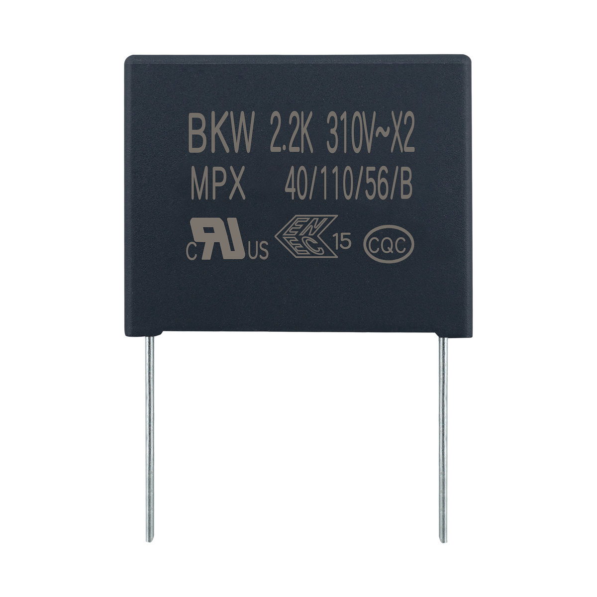

# MPX 金属化聚丙烯膜抑制干扰用固定电容器(X2类别) 110℃

**MPX Metallized Polypropylene Film Interference Suppression capacitor(Class X2) 110℃**

- 品牌 / Brand: **BKW**
- 制造商 / Manufacturer: 东莞博可威电子科技有限公司 / Dongguan BoKeWei Electronic Technology Co., Ltd
- 行业型号 / Industry code: `CBB62`
- 额定温度 / Rated temperature: 110℃
- 类型 / Type: 金属化聚丙烯膜抑制干扰用固定电容器(X2类别) / Metallized Polypropylene Film Interference Suppression capacitor(Class X2)
- 认证 / Approvals: CQC CQC24001434015；ENEC-DEMKO ENEC-04959；UL/CUL E542153
- 结构化数据 / Structured data: [`MPX.json`](./MPX.json)

## 概述 / Overview

MPX 是东莞博可威电子科技有限公司（BKW）的金属化聚丙烯膜抑制干扰用固定电容器(X2类别)（行业型号 CBB62），额定电压 310Vac（50/60Hz），电容量范围 0.001μF~10μF，工作温度范围 -40℃~+110℃，气候类别 40/110/56/B；已取得 UL（E542153）、ENEC（ENEC-04959）与 CQC（CQC24001434015）认证。

BKW MPX: Metallized Polypropylene Film Interference Suppression capacitor(Class X2) (industry code CBB62). Rated voltage 310Vac (50/60Hz), capacitance 0.001μF–10μF, operating temperature -40℃ to +110℃, climatic category 40/110/56/B; approved by UL (E542153), ENEC (ENEC-04959) and CQC (CQC24001434015).

## 认证 / Approvals

| 认证机构 / Body | 地区 / Region | 标准 / Standard | 证书编号 / Certificate no. |
| --- | --- | --- | --- |
| CQC | 中国 | IEC60384-14:2013+AMD1:2016 | CQC24001434015 |
| ENEC-DEMKO | 欧盟 | EN IEC 60384-14:2023 | ENEC-04959 |
| UL/CUL | 美国/加拿大 | UL 60384-14, CAN/CSA-E60384-14 | E542153 |

## 技术参数 / Technical specifications

| 项目 / Item (zh) | Item (en) | 数值 / Value |
| --- | --- | --- |
| 气候类别/阻燃等级 | Climatic Category/Passive Flammability Category | 40/110/56/B |
| 工作温度范围 | Operating Temperature Range | -40℃~+110℃ |
| 额定电压 | Rated Voltage (U_R) | 310Vac, 50Hz/60Hz |
| 最大额定电源电压 | Max rated supply mains voltage | 250Vac, 50Hz/60Hz |
| 电容量范围 | Capacitance Range | 0.001μF ~ 10μF |
| 电容量偏差 | Capacitance Tolerance | ±10%(K), ±20%(M) |
| 耐电压 — 引线之间 | Voltage Proof — Between Terminals | 4.3U_R (Vdc), 2s |
| 耐电压 — 极壳之间 | Voltage Proof — Between Terminals To Case | 1500+2U_R Vac, 1min |
| 损耗角正切 | Dissipation Factor (tanδ) | ≤0.1% (1kHz at 20~25℃) |
| 绝缘电阻 | Insulation Resistance | ≥15000MΩ, C_N≤0.33μF; RC_N≥5000s, C_N>0.33μF (20℃, 100V, 1min) |

## 外形尺寸与规格表 / Dimensions and rating tables

### 外形尺寸 / Dimensions (mm)

| C_R (μF) | W (±1) | H (±1) | T (±1) | P (±1) | DΦ (±0.05) |
| --- | --- | --- | --- | --- | --- |
| 0.001 | 10 | 9 | 4 | 7.5 | 0.5 |
| 0.0022 | 10 | 9 | 4 | 7.5 | 0.5 |
| 0.0033 | 10 | 9 | 4 | 7.5 | 0.5 |
| 0.0047 | 10 | 9 | 4 | 7.5 | 0.5 |
| 0.0068 | 10 | 9 | 4 | 7.5 | 0.5 |
| 0.01 | 10 | 9 | 4 | 7.5 | 0.5 |
| 0.015 | 10 | 9 | 4 | 7.5 | 0.5 |
| 0.018 | 10 | 9 | 4 | 7.5 | 0.5 |
| 0.022 | 10 | 9 | 4 | 7.5 | 0.5 |
| 0.033 | 10 | 11 | 5 | 7.5 | 0.5 |
| 0.001 | 13 | 9 | 4 | 10 | 0.5 |
| 0.0022 | 13 | 9 | 4 | 10 | 0.5 |
| 0.0033 | 13 | 9 | 4 | 10 | 0.5 |
| 0.0047 | 13 | 9 | 4 | 10 | 0.5 |
| 0.0068 | 13 | 9 | 4 | 10 | 0.5 |
| 0.01 | 13 | 9 | 4 | 10 | 0.6 |
| 0.022 | 13 | 9 | 4 | 10 | 0.6 |
| 0.033 | 13 | 11 | 5 | 10 | 0.6 |
| 0.1 | 13 | 11 | 5 | 10 | 0.6 |
| 0.1 | 13 | 12 | 6 | 10 | 0.6 |
| 0.15 | 13 | 12 | 6 | 10 | 0.6 |
| 0.22 | 13 | 14 | 8 | 10 | 0.6 |
| 0.22 | 13 | 16 | 8 | 10 | 0.6 |
| 0.33 | 13 | 16 | 8 | 10 | 0.6 |
| 0.47 | 13 | 19 | 9 | 10 | 0.6 |
| 0.68 | 13 | 21 | 11 | 10 | 0.6 |
| 0.1 | 18 | 11 | 5 | 15 | 0.6 |
| 0.1 | 18 | 12 | 6 | 15 | 0.6 |
| 0.22 | 18 | 12 | 6 | 15 | 0.6 |
| 0.22 | 18 | 13.5 | 7.5 | 15 | 0.6 |
| 0.33 | 18 | 13 | 7 | 15 | 0.8 |
| 0.33 | 18 | 14.5 | 8.5 | 15 | 0.8 |
| 0.47 | 18 | 14.5 | 8.5 | 15 | 0.8 |
| 0.47 | 18 | 17.5 | 10 | 15 | 0.8 |
| 0.56 | 18 | 19 | 11 | 15 | 0.8 |
| 0.68 | 18 | 16 | 10 | 15 | 0.8 |
| 0.68 | 18 | 19 | 11 | 15 | 0.8 |
| 0.22 | 26.5 | 15 | 6 | 22.5 | 0.6 |
| 0.22 | 26.5 | 16.5 | 7 | 22.5 | 0.8 |
| 0.33 | 26.5 | 16.5 | 7 | 22.5 | 0.8 |
| 0.33 | 26.5 | 17 | 8.5 | 22.5 | 0.8 |
| 0.47 | 26.5 | 17 | 8.5 | 22.5 | 0.8 |
| 0.47 | 26.5 | 19 | 10 | 22.5 | 0.8 |
| 0.68 | 26.5 | 19 | 10 | 22.5 | 0.8 |
| 1.0 | 26 | 20 | 11 | 22.5 | 0.8 |
| 1.2 | 26 | 22 | 12 | 22.5 | 0.8 |
| 1.5 | 26 | 22 | 12 | 22.5 | 0.8 |
| 0.68 | 31.5 | 19.5 | 11 | 27.5 | 0.8 |
| 0.82 | 31.5 | 19.5 | 11 | 27.5 | 0.8 |
| 1.0 | 31.5 | 19.5 | 11 | 27.5 | 0.8 |
| 1.0 | 31.5 | 22 | 13 | 27.5 | 0.8 |
| 1.2 | 31.5 | 19.5 | 11 | 27.5 | 0.8 |
| 1.2 | 31.5 | 22 | 13 | 27.5 | 0.8 |
| 1.2 | 31.5 | 25 | 14 | 27.5 | 0.8 |
| 1.5 | 31.5 | 22 | 13 | 27.5 | 0.8 |
| 1.5 | 31.5 | 25 | 14 | 27.5 | 0.8 |
| 1.5 | 31.5 | 25.5 | 16 | 27.5 | 0.8 |
| 1.5 | 31.5 | 26 | 18 | 27.5 | 0.8 |
| 1.8 | 31.5 | 26 | 18 | 27.5 | 0.8 |
| 2.2 | 31.5 | 28 | 18 | 27.5 | 0.8 |
| 2.7 | 31.5 | 28 | 18 | 27.5 | 0.8 |
| 3.3 | 31.5 | 28 | 18 | 27.5 | 0.8 |
| 4.4 | 31 | 31 | 22 | 27.5 | 0.8 |
| 4.7 | 32 | 37 | 22 | 27.5 | 0.8 |
| 5.6 | 32 | 37 | 22 | 27.5 | 0.8 |
| 2.2 | 38 | 30 | 20 | 31.5 | 0.8 |
| 3.3 | 35.5 | 31 | 20 | 31.5 | 0.8 |
| 4.7 | 42 | 37 | 22 | 37.5 | 1.0 |
| 6.8 | 42 | 37 | 22 | 37.5 | 1.0 |
| 8.2 | 42 | 41 | 27.5 | 37.5 | 1.0 |
| 10.0 | 42 | 45 | 30 | 37.5 | 1.0 |
| 6.8 | 57 | 50 | 30 | 52.5 | 1.0 |
| 8.2 | 57 | 50 | 35 | 52.5 | 1.0 |
| 10.0 | 57 | 50 | 40 | 52.5 | 1.0 |

## 联系方式 / Contact

- 东莞博可威电子科技有限公司 / Dongguan BoKeWei Electronic Technology Co., Ltd
- 地址 / Address: 广东省东莞市松山湖园区科技十路1号1栋802室
- 电话 / Tel: 0769-82322786
- 邮箱 / Email: bokewei_tech@163.com
- 公司介绍 / About the company: [company.md](../../company.md)

---

规格如有变更，以本资料库最新版本为准。 / Specifications are subject to change; this repository is the latest public reference.
