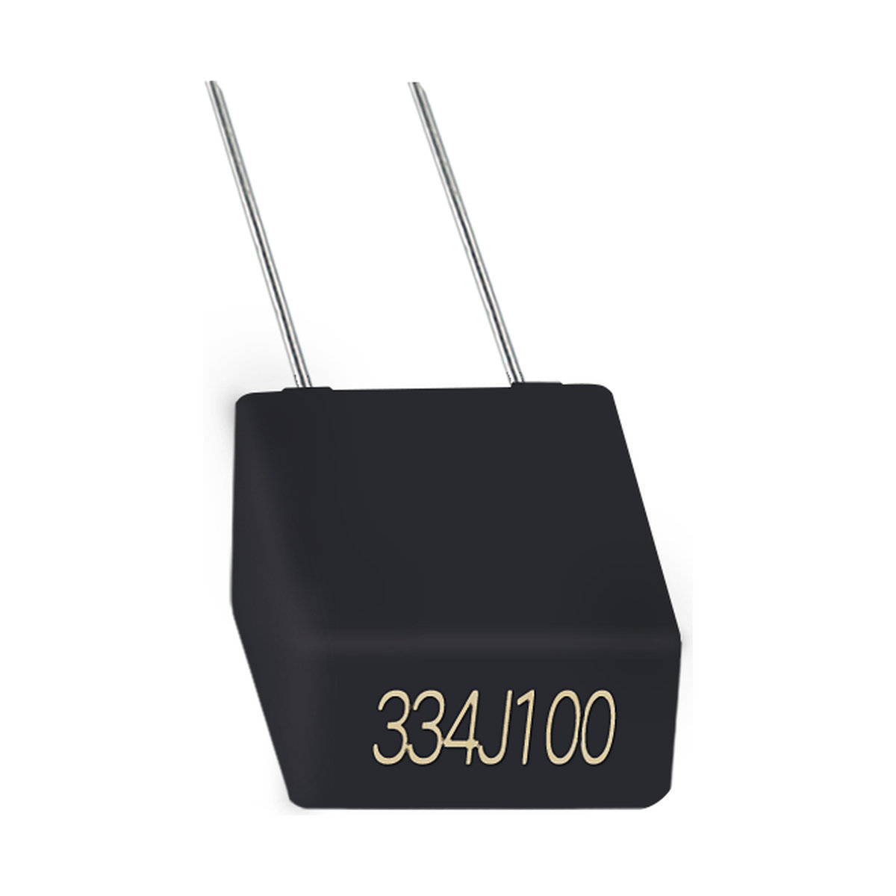

# SMB 超小型金属化聚酯膜电容器(盒装型) 100℃

**SMB Subminiature metalized polyester film capacitor (Box-type) 100℃**

- 品牌 / Brand: **BKW**
- 制造商 / Manufacturer: 东莞博可威电子科技有限公司 / Dongguan BoKeWei Electronic Technology Co., Ltd
- 行业型号 / Industry code: `CL23`
- 额定温度 / Rated temperature: 100℃
- 类型 / Type: 超小型金属化聚酯膜电容器(盒装型) / Subminiature metalized polyester film capacitor (Box-type)
- 结构化数据 / Structured data: [`SMB.json`](./SMB.json)

## 概述 / Overview

SMB 是东莞博可威电子科技有限公司（BKW）的超小型金属化聚酯膜电容器(盒装型)（行业型号 CL23），额定电压 63VDC~630VDC，电容量范围 0.0010μF~2.2μF，气候类别 40/100/21；用于直流低脉冲场合，如功放、彩电、通讯、电源等对可靠性要求较高的电路；可依需求制作特殊规格。

BKW SMB: Subminiature metalized polyester film capacitor (Box-type) (industry code CL23). Rated voltage 63–630VDC, capacitance 0.0010μF–2.2μF, climatic category 40/100/21; for DC low-pulse applications such as amplifiers, TVs, communications and power supplies requiring high reliability. Special specifications on request.

## 应用 / Applications

- 本品用于直流低脉冲场合，广泛用于功放、彩电、通讯、电源等对产品可靠性要求较高的电路中。 / Widely used for DC low pulse portion of occasions, widely used in amplifier, TV, communications, power supply and other products requiring high reliability circuit.

## 技术参数 / Technical specifications

| 项目 / Item (zh) | Item (en) | 数值 / Value |
| --- | --- | --- |
| 气候类别/阻燃等级 | Climatic Category/Passive Flammability Category | 40/100/21 |
| 额定电压 | Rated Voltage (U_R) | 63VDC, 100VDC, 250VDC, 400VDC, 630VDC |
| 电容量范围 | Capacitance Range | 0.0010μF~2.2μF |
| 电容量偏差 | Capacitance Tolerance | ±5%(J), ±10%(K) |
| 耐电压 | Voltage Proof | 1.6 U_R |
| 绝缘电阻 | Insulation Resistance (20℃, 100V, 1min) | ≥3000MΩ, C_N≤0.33μF; R·C_N≥1000s, C_N>0.33μF |
| 损耗角正切 | Dissipation Factor (tanδ) | ≤0.008 (1kHz at 20~25℃) |

## 外形尺寸与规格表 / Dimensions and rating tables

### 外形尺寸（可依需求制作特殊规格）— 各电压可选壳号 / Dimensions (mm), case codes per rated voltage

| 规格 pF code | 容量 μF | 63V | 100V | 250V | 400V | 630V |
| --- | --- | --- | --- | --- | --- | --- |
| 102 | 0.0010 | M1 | M1 | M1,M2 | M2,M3 | M2,M3 |
| 152 | 0.0015 | M1 | M1 | M1,M2 | M2,M3 | M2,M3 |
| 222 | 0.0022 | M1 | M1 | M1,M2 | M2,M3 | M2,M3 |
| 332 | 0.0033 | M1 | M1 | M1,M2 | M2,M3 | M2,M3 |
| 472 | 0.0047 | M1 | M1 | M1,M2 | M2,M3 | M2,M3 |
| 682 | 0.0068 | M1 | M1 | M1,M2 | M2,M3 | M2,M3 |
| 103 | 0.010 | M1 | M1 | M1,M2 | M2,M3 | M3 |
| 153 | 0.015 | M1 | M1 | M1,M2 | M2,M3 | M3,M4 |
| 223 | 0.022 | M1 | M1 | M1,M2 | M2,M3 | M4,M5 |
| 333 | 0.033 | M1 | M1 | M1,M2 | M2,M3 | M4,M5 |
| 473 | 0.047 | M1 | M1 | M1,M2 | M2,M3 |  |
| 683 | 0.068 | M1 | M1 | M2,M3 | M3,M4 |  |
| 104 | 0.10 | M1 | M1 | M3 | M4 |  |
| 154 | 0.15 | M1 | M1 | M3,M4 | M4,M5 |  |
| 224 | 0.22 | M1 | M1,M2 | M5 | M5 |  |
| 334 | 0.33 | M2,M3 | M2,M3 | M5 |  |  |
| 474 | 0.47 | M2,M3,M4 | M2,M3,M4 |  |  |  |
| 684 | 0.68 | M4,M5 | M4,M5 |  |  |  |
| 105 | 1.0 | M5 | M5 |  |  |  |
| 155 | 1.5 | M5 | M5 |  |  |  |
| 225 | 2.2 | M5 | M5 |  |  |  |

空白格表示该电压无此规格；壳号尺寸见下表。 / Blank: not available at that voltage; see case sizes below.

### 壳号尺寸 W*H*T / Case sizes W*H*T (mm)

| 壳号 Case | W*H*T |
| --- | --- |
| M1 | 7.2*6.5*2.5 |
| M2 | 7.2*7.5*3.5 |
| M3 | 7.2*9.5*4.5 |
| M4 | 7.2*10*5 |
| M5 | 7.2*11*6 |

## 联系方式 / Contact

- 东莞博可威电子科技有限公司 / Dongguan BoKeWei Electronic Technology Co., Ltd
- 地址 / Address: 广东省东莞市松山湖园区科技十路1号1栋802室
- 电话 / Tel: 0769-82322786
- 邮箱 / Email: bokewei_tech@163.com
- 公司介绍 / About the company: [company.md](../../company.md)

---

规格如有变更，以本资料库最新版本为准。 / Specifications are subject to change; this repository is the latest public reference.
