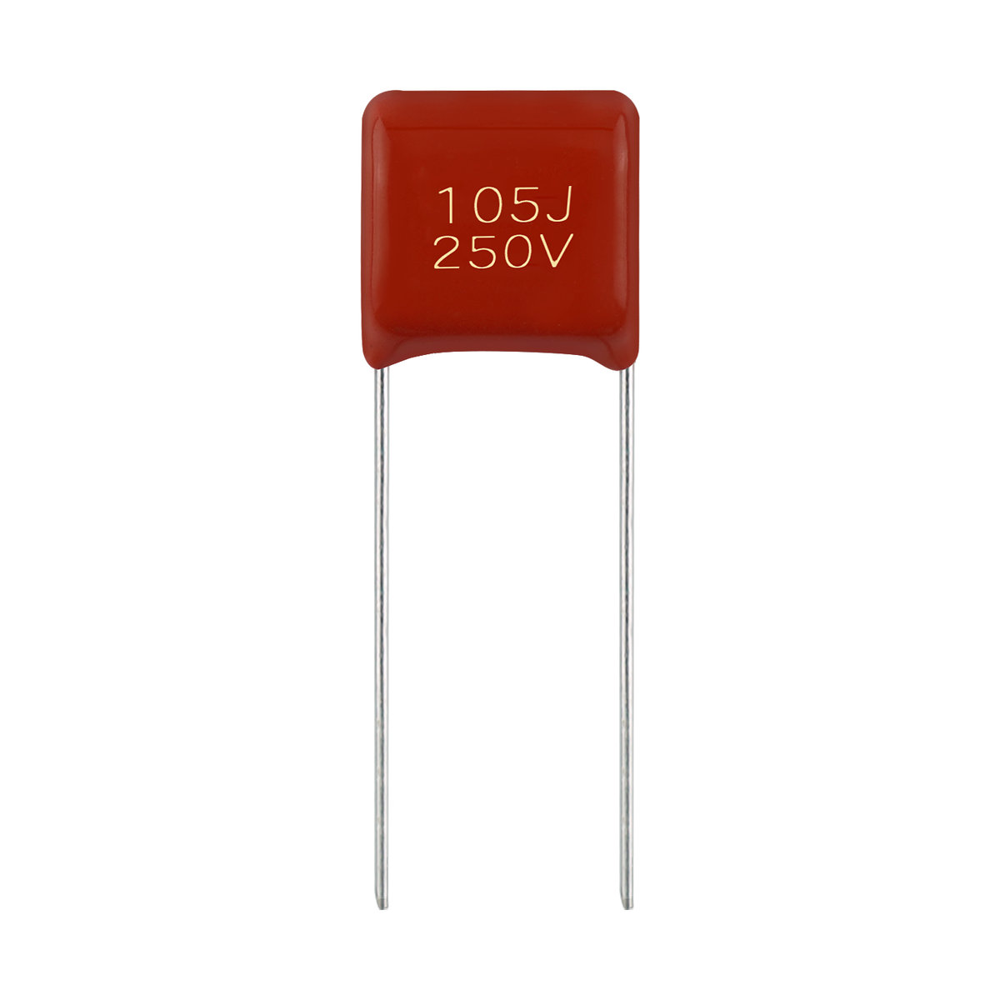

# SMC 超小型金属化聚丙烯膜电容器(浸渍型) 85℃

**SMC Subminiature metalized polypropylene film capacitor (Dipped-type) 85℃**

- 品牌 / Brand: **BKW**
- 制造商 / Manufacturer: 东莞博可威电子科技有限公司 / Dongguan BoKeWei Electronic Technology Co., Ltd
- 行业型号 / Industry code: `CBB21X`
- 额定温度 / Rated temperature: 85℃
- 类型 / Type: 超小型金属化聚丙烯膜电容器(浸渍型) / Subminiature metalized polypropylene film capacitor (Dipped-type)
- 结构化数据 / Structured data: [`SMC.json`](./SMC.json)
- 规格书 PDF / Datasheet PDF: [`BKW_SMC_规格书.pdf`](./BKW_SMC_规格书.pdf)

## 概述 / Overview

SMC 是东莞博可威电子科技有限公司（BKW）的超小型金属化聚丙烯膜电容器(浸渍型)（行业型号 CBB21X），额定电压 63VDC~1000VDC，标准品电容量范围 0.0010μF~0.33μF（更大容量可定制），气候类别 40/85/21；用于各种要求低损耗或高容量精度的电路。

BKW SMC: Subminiature metalized polypropylene film capacitor (Dipped-type) (industry code CBB21X). Rated voltage 63–1000VDC, standard capacitance 0.0010μF–0.33μF (larger values available as custom products), climatic category 40/85/21; for circuits requiring low loss or high capacitance accuracy.

## 应用 / Applications

- 本品用于各种要求低损耗或高容量精度的电路。 / This product is used for the various requirements of low loss or high precision circuits.

## 技术参数 / Technical specifications

| 项目 / Item (zh) | Item (en) | 数值 / Value |
| --- | --- | --- |
| 气候类别/阻燃等级 | Climatic Category/Passive Flammability Category | 40/85/21 |
| 额定电压 | Rated Voltage (U_R) | 63VDC, 100VDC, 200VDC, 250VDC, 400VDC, 630VDC, 1000VDC |
| 电容量范围 | Capacitance Range | 标准品 0.0010μF~0.33μF；更大容量可定制（非标定制品） / Standard: 0.0010μF~0.33μF; larger capacitances available as non-standard (customer-specific) |
| 电容量偏差 | Capacitance Tolerance | ±5%(J), ±10%(K) |
| 耐电压 | Voltage Proof | 1.6 U_R |
| 绝缘电阻 | Insulation Resistance (20℃, 100V, 1min) | ≥15000MΩ, C_N≤0.33μF; R·C_N≥5000s, C_N>0.33μF |
| 损耗角正切 | Dissipation Factor (tanδ) | ≤0.08% (1kHz at 20~25℃) |

## 外形尺寸与规格表 / Dimensions and rating tables

### 外形尺寸 / Dimensions (mm)

| 规格 Grade | C_R (μF) | 63/100VDC W | 63/100VDC H | 63/100VDC T | 63/100VDC P | 63/100VDC D | 200/250VDC W | 200/250VDC H | 200/250VDC T | 200/250VDC P | 200/250VDC D | 400VDC W | 400VDC H | 400VDC T | 400VDC P | 400VDC D | 630/1000VDC W | 630/1000VDC H | 630/1000VDC T | 630/1000VDC P | 630/1000VDC D |
| --- | --- | --- | --- | --- | --- | --- | --- | --- | --- | --- | --- | --- | --- | --- | --- | --- | --- | --- | --- | --- | --- |
| 标准品 | 0.0010 | 7.2 | 7.2 | 4.0 | 5.0 | 0.5 | 7.2 | 7.2 | 4.0 | 5.0 | 0.5 | 7.2 | 7.2 | 4.0 | 5.0 | 0.5 | 7.2 | 7.2 | 4.0 | 5.0 | 0.5 |
| 标准品 | 0.0012 | 7.2 | 7.2 | 4.0 | 5.0 | 0.5 | 7.2 | 7.2 | 4.0 | 5.0 | 0.5 | 7.2 | 7.2 | 4.0 | 5.0 | 0.5 | 7.2 | 7.2 | 4.0 | 5.0 | 0.5 |
| 标准品 | 0.0015 | 7.2 | 7.2 | 4.0 | 5.0 | 0.5 | 7.2 | 7.2 | 4.0 | 5.0 | 0.5 | 7.2 | 7.2 | 4.0 | 5.0 | 0.5 | 7.2 | 7.2 | 4.0 | 5.0 | 0.5 |
| 标准品 | 0.0018 | 7.2 | 7.2 | 4.0 | 5.0 | 0.5 | 7.2 | 7.2 | 4.0 | 5.0 | 0.5 | 7.2 | 7.2 | 4.0 | 5.0 | 0.5 | 7.2 | 7.2 | 4.0 | 5.0 | 0.5 |
| 标准品 | 0.0022 | 7.2 | 7.2 | 4.0 | 5.0 | 0.5 | 7.2 | 7.2 | 4.0 | 5.0 | 0.5 | 7.2 | 7.2 | 4.0 | 5.0 | 0.5 | 7.2 | 7.2 | 4.0 | 5.0 | 0.5 |
| 标准品 | 0.0027 | 7.2 | 7.2 | 4.0 | 5.0 | 0.5 | 7.2 | 7.2 | 4.0 | 5.0 | 0.5 | 7.2 | 7.2 | 4.0 | 5.0 | 0.5 | 7.2 | 7.2 | 4.0 | 5.0 | 0.5 |
| 标准品 | 0.0033 | 7.2 | 7.2 | 4.0 | 5.0 | 0.5 | 7.2 | 7.2 | 4.0 | 5.0 | 0.5 | 7.2 | 7.2 | 4.0 | 5.0 | 0.5 | 7.2 | 7.2 | 4.0 | 5.0 | 0.5 |
| 标准品 | 0.0039 | 7.2 | 7.2 | 4.0 | 5.0 | 0.5 | 7.2 | 7.2 | 4.0 | 5.0 | 0.5 | 7.2 | 7.2 | 4.0 | 5.0 | 0.5 | 7.2 | 7.2 | 4.0 | 5.0 | 0.5 |
| 标准品 | 0.0047 | 7.2 | 7.2 | 4.0 | 5.0 | 0.5 | 7.2 | 7.2 | 4.0 | 5.0 | 0.5 | 7.2 | 7.2 | 4.0 | 5.0 | 0.5 | 7.2 | 7.2 | 4.0 | 5.0 | 0.5 |
| 标准品 | 0.0056 | 7.2 | 7.2 | 4.0 | 5.0 | 0.5 | 7.2 | 7.2 | 4.0 | 5.0 | 0.5 | 7.2 | 7.2 | 4.0 | 5.0 | 0.5 | 7.2 | 7.2 | 4.0 | 5.0 | 0.5 |
| 标准品 | 0.0068 | 7.2 | 7.2 | 4.0 | 5.0 | 0.5 | 7.2 | 7.2 | 4.0 | 5.0 | 0.5 | 7.2 | 7.2 | 4.0 | 5.0 | 0.5 | 7.2 | 7.2 | 4.0 | 5.0 | 0.5 |
| 标准品 | 0.0082 | 7.2 | 7.2 | 4.0 | 5.0 | 0.5 | 7.2 | 7.2 | 4.0 | 5.0 | 0.5 | 7.2 | 7.2 | 4.0 | 5.0 | 0.5 | 7.2 | 7.5 | 4.5 | 5.0 | 0.5 |
| 标准品 | 0.010 | 7.2 | 7.2 | 4.0 | 5.0 | 0.5 | 7.2 | 7.2 | 4.0 | 5.0 | 0.5 | 7.2 | 7.2 | 4.0 | 5.0 | 0.5 | 7.2 | 8.0 | 4.8 | 5.0 | 0.5 |
| 标准品 | 0.012 | 7.2 | 7.2 | 4.0 | 5.0 | 0.5 | 7.2 | 7.2 | 4.0 | 5.0 | 0.5 | 7.2 | 7.2 | 4.0 | 5.0 | 0.5 | 7.2 | 8.5 | 5.0 | 5.0 | 0.5 |
| 标准品 | 0.015 | 7.2 | 7.2 | 4.0 | 5.0 | 0.5 | 7.2 | 7.2 | 4.0 | 5.0 | 0.5 | 7.2 | 7.2 | 4.0 | 5.0 | 0.5 | 7.2 | 8.8 | 5.2 | 5.0 | 0.5 |
| 标准品 | 0.018 | 7.2 | 7.2 | 4.0 | 5.0 | 0.5 | 7.2 | 7.2 | 4.0 | 5.0 | 0.5 | 7.2 | 7.2 | 4.0 | 5.0 | 0.5 | 7.2 | 9.0 | 5.3 | 5.0 | 0.5 |
| 标准品 | 0.022 | 7.2 | 7.2 | 4.0 | 5.0 | 0.5 | 7.2 | 7.2 | 4.0 | 5.0 | 0.5 | 7.2 | 7.2 | 4.0 | 5.0 | 0.5 | 7.2 | 9.3 | 5.5 | 5.0 | 0.5 |
| 标准品 | 0.027 | 7.2 | 7.2 | 4.0 | 5.0 | 0.5 | 7.2 | 7.2 | 4.0 | 5.0 | 0.5 | 7.2 | 7.2 | 4.0 | 5.0 | 0.5 | 7.2 | 9.5 | 5.6 | 5.0 | 0.5 |
| 标准品 | 0.033 | 7.2 | 7.2 | 4.0 | 5.0 | 0.5 | 7.2 | 7.2 | 4.0 | 5.0 | 0.5 | 7.2 | 7.2 | 4.0 | 5.0 | 0.5 | 7.2 | 9.8 | 5.8 | 5.0 | 0.5 |
| 标准品 | 0.039 | 7.2 | 7.2 | 4.0 | 5.0 | 0.5 | 7.2 | 7.2 | 4.0 | 5.0 | 0.5 | 7.2 | 7.2 | 4.0 | 5.0 | 0.5 | 7.2 | 10.2 | 6.0 | 5.0 | 0.5 |
| 标准品 | 0.047 | 7.2 | 7.2 | 4.0 | 5.0 | 0.5 | 7.2 | 7.2 | 4.0 | 5.0 | 0.5 | 7.2 | 7.2 | 4.0 | 5.0 | 0.5 | 7.2 | 11.5 | 6.5 | 5.0 | 0.5 |
| 标准品 | 0.056 | 7.2 | 7.2 | 4.0 | 5.0 | 0.5 | 7.2 | 7.5 | 4.5 | 5.0 | 0.5 | 7.2 | 8.5 | 4.5 | 5.0 | 0.5 |  |  |  |  |  |
| 标准品 | 0.068 | 7.2 | 7.2 | 4.0 | 5.0 | 0.5 | 7.2 | 7.5 | 4.5 | 5.0 | 0.5 | 7.2 | 9.0 | 5.0 | 5.0 | 0.5 |  |  |  |  |  |
| 标准品 | 0.082 | 7.2 | 7.2 | 4.0 | 5.0 | 0.5 | 7.2 | 8.5 | 4.5 | 5.0 | 0.5 | 7.2 | 9.0 | 5.0 | 5.0 | 0.5 |  |  |  |  |  |
| 标准品 | 0.10 | 7.2 | 7.2 | 4.0 | 5.0 | 0.5 | 7.2 | 8.5 | 4.5 | 5.0 | 0.5 | 7.2 | 10.0 | 5.5 | 5.0 | 0.5 |  |  |  |  |  |
| 标准品 | 0.12 | 7.2 | 7.5 | 4.5 | 5.0 | 0.5 | 7.2 | 9.0 | 5.0 | 5.0 | 0.5 | 7.2 | 10.0 | 5.5 | 5.0 | 0.5 |  |  |  |  |  |
| 标准品 | 0.15 | 7.2 | 7.5 | 4.5 | 5.0 | 0.5 | 7.2 | 9.0 | 5.0 | 5.0 | 0.5 | 7.2 | 11.0 | 6.0 | 5.0 | 0.5 |  |  |  |  |  |
| 标准品 | 0.18 | 7.2 | 7.5 | 4.5 | 5.0 | 0.5 | 7.2 | 10.0 | 5.5 | 5.0 | 0.5 | 7.2 | 11.5 | 6.5 | 5.0 | 0.5 |  |  |  |  |  |
| 标准品 | 0.22 | 7.2 | 7.5 | 4.5 | 5.0 | 0.5 | 7.2 | 10.0 | 5.5 | 5.0 | 0.5 | 7.2 | 12.0 | 7.0 | 5.0 | 0.5 |  |  |  |  |  |
| 标准品 | 0.27 | 7.2 | 7.5 | 4.5 | 5.0 | 0.5 | 7.2 | 11.0 | 6.0 | 5.0 | 0.5 |  |  |  |  |  |  |  |  |  |  |
| 标准品 | 0.33 | 7.2 | 8.5 | 4.5 | 5.0 | 0.5 | 7.2 | 12.0 | 7.0 | 5.0 | 0.5 |  |  |  |  |  |  |  |  |  |  |
| 非标定制品 | 0.39 | 7.2 | 8.5 | 4.5 | 5.0 | 0.5 | 7.2 | 12.0 | 7.0 | 5.0 | 0.5 |  |  |  |  |  |  |  |  |  |  |
| 非标定制品 | 0.47 | 7.2 | 9.0 | 5.0 | 5.0 | 0.5 |  |  |  |  |  |  |  |  |  |  |  |  |  |  |  |
| 非标定制品 | 0.56 | 7.2 | 9.0 | 5.0 | 5.0 | 0.5 |  |  |  |  |  |  |  |  |  |  |  |  |  |  |  |
| 非标定制品 | 0.68 | 7.2 | 10.0 | 5.0 | 5.0 | 0.5 |  |  |  |  |  |  |  |  |  |  |  |  |  |  |  |
| 非标定制品 | 0.82 | 7.2 | 11.5 | 5.2 | 5.0 | 0.5 |  |  |  |  |  |  |  |  |  |  |  |  |  |  |  |
| 非标定制品 | 1.00 | 7.2 | 12.0 | 5.6 | 5.0 | 0.5 |  |  |  |  |  |  |  |  |  |  |  |  |  |  |  |
| 非标定制品 | 1.20 | 7.2 | 12.5 | 6.5 | 5.0 | 0.5 |  |  |  |  |  |  |  |  |  |  |  |  |  |  |  |
| 非标定制品 | 2.20 | 7.2 | 12.5 | 7.0 | 5.0 | 0.5 |  |  |  |  |  |  |  |  |  |  |  |  |  |  |  |

空白格表示该电压无此容量。≤0.33μF 为标准品，>0.33μF 为非标定制品（客户特别订制）。 / Blank: not available at that voltage. ≤0.33μF standard; >0.33μF non-standard (custom).

## 联系方式 / Contact

- 东莞博可威电子科技有限公司 / Dongguan BoKeWei Electronic Technology Co., Ltd
- 地址 / Address: 广东省东莞市松山湖园区科技十路1号1栋802室
- 电话 / Tel: 0769-82322786
- 邮箱 / Email: bokewei_tech@163.com
- 公司介绍 / About the company: [company.md](../../company.md)

---

规格如有变更，以本资料库最新版本为准。 / Specifications are subject to change; this repository is the latest public reference.
